<div align="center">

# opssat-ad-onset-signatures

### Joint false-alarm calibration of location and moving-range alarm channels: a dependence-aware evaluation protocol for nested telemetry

**Code, data-provenance and figure-reproduction companion to the manuscript. Benchmarks: SMD · SMAP/MSL · OPS-SAT-AD**

[](./LICENSE)
[](https://www.python.org/)
[](#9-reproducing-every-number)
[](#11-data-and-code-availability)

</div>

> **TL;DR.** Alarm rules are usually adopted on offline validation that neither fixes the false-alarm budget nor respects the nesting of labelled telemetry. This repository places a **successive-difference dispersion channel** (the counterpart of the moving-range chart) and a **level channel** under **one joint placebo false-alarm rate (FAR)**, and implements a **dependence-aware evaluation protocol**: cluster resampling at the unit of repeat, reference pivots matched to the onset source, and grouped held-out calibration. In SMD, an OR-fused rule calibrated to a 5% joint placebo FAR raises held-out coverage by **+1.3 percentage points (95% CI 0.4 to 2.3)** at an unchanged false-alarm burden. An **I-MR scheme calibrated on the same joint budget matches it (−0.1 points)**, so the gain is a *calibration* result, not a new-chart result. An **inflation ledger** converts eight evaluation choices into reporting rules R1 to R8.

The repository name is kept for link stability; its scope is broader than OPS-SAT. The code is self-contained and does not depend on any other repository. Datasets are not redistributed.

---

## Table of Contents

1. [Overview](#1-overview)
2. [Quick start](#2-quick-start)
3. [Data and scope](#3-data-and-scope)
4. [Methods](#4-methods)
5. [Results](#5-results)
6. [Alarm design playbook and inflation ledger](#6-alarm-design-playbook-and-inflation-ledger)
7. [Scope, limits and roadmap](#7-scope-limits-and-roadmap)
8. [Repository structure](#8-repository-structure)
9. [Reproducing every number](#9-reproducing-every-number)
10. [Artifact index](#10-artifact-index)
11. [Data and code availability](#11-data-and-code-availability)
12. [References](#12-references)

---

## 1. Overview

### 1.1 The problem, and the four questions this repo answers

An alarm rule converts monitored signals into operator actions. Its design trades detection coverage against nuisance alarms that consume operator attention (ANSI/ISA-18.2). Most deployed alarm logic thresholds a standardised signal value (a location statistic). Statistical process monitoring offers further channels, among them dispersion statistics built on successive differences, which are unaffected by a constant offset and correspond to the moving-range chart of the individuals–moving-range (I-MR) scheme.

Offline validation of such rules on labelled telemetry has three recurring weaknesses:

1. **Labels repeat inside units.** Anomalous segments cluster in few channels (OPS-SAT-AD: five usable channels), machines (SMD: 28) or missions. An interval that treats segments as independent covers one estimand at 96% and another at 79% (Fig. 6b).
2. **The reference is constructed.** The "normal" pivots that onsets are compared with are position-matched resamples or detector outputs. Their construction moved the OPS-SAT-AD `diff` AUROC from 0.900 to 0.569 (Fig. 3c).
3. **Threshold-crossing criteria hide their operating point and tie convention.** A fixed |z| > 3 rule runs at a placebo FAR of 27% to 46%, and integer-sample ties reversed the sign of one contrast (Fig. 7).

The repository is organised around four questions. Every section below is tagged with the question it serves.

| # | Question | Short answer | Evidence | Status |
|---|---|---|---|---|
| **Q1** | **Direction.** Does a dispersion feature (`diff`, `diff²`) separate onsets from same-channel placebo pivots better than `level`? | Yes against pooled-SD `level` in 3/3 benchmarks (Δ AUROC +0.042, +0.122, +0.462). Against a pre-onset-SD `level` it is not distinguishable in SMD and SMAP/MSL (+0.010, +0.060) and stays ahead in OPS-SAT-AD (+0.447). | Tables 7, 15; Fig. 6a | Established (direction); size depends on the `level` definition |
| **Q2** | **Sufficiency.** Once dispersion features are in the rule, does `level` add anything? | No out-of-fold discrimination in any benchmark (upper 95% limits +0.013, +0.024, −0.0001). | Table 9 | Established |
| **Q3** | **Operating value.** At a matched FAR, how much coverage does a fused rule add, and how does it compare with Shewhart, CUSUM, EWMA and I-MR? | SMD, 5% FAR: **+1.3 pp held-out** (+1.2 in-sample). Exceeds CUSUM and EWMA mean charts by 3.5 and 1.6 pp; **matched by I-MR (−0.1 pp)**. | Tables 16, 16b; Figs. 6c | Established (SMD); descriptive (SMAP/MSL, 56 windows) |
| **Q4** | **Trust.** How much of an advantage survives dependence-aware evaluation, and what must a report state? | Eight evaluation choices move the apparent advantage; each is quantified and turned into a reporting rule. | Table 26, Section 6 | Quantified |

### 1.2 What the repo does

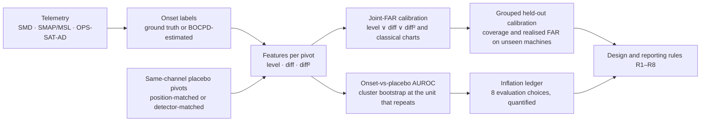

### 1.3 Results at a glance

**Q1: onset-versus-placebo AUROC** (cluster bootstrap; chance = 0.5 = 10 blocks; each block = 0.05).

```text
                                         AUROC
SMD (28 machines, 327 events)
  level      ███████████░░░░░░░░░        0.534
  diff       ████████████░░░░░░░░        0.576
  diff²      ████████████░░░░░░░░        0.576

SMAP/MSL (81 channels, 88 windows)
  level      ███████████░░░░░░░░░        0.554
  diff       ██████████████░░░░░░        0.677
  diff²      █████████████░░░░░░░        0.642

OPS-SAT-AD, position-matched placebo (168 events)
  level      █████████░░░░░░░░░░░        0.438
  diff       ██████████████████░░        0.900
  diff²      ██████████████████░░        0.917

OPS-SAT-AD, detector-matched placebo (same detector for onsets and pivots)
  level      ████████░░░░░░░░░░░░        0.382   (direction-agnostic 0.618)
  diff       ███████████░░░░░░░░░        0.569
  diff²      ██████████████░░░░░░        0.720
```

**Q3: what the fused rule adds in SMD** (coverage gain of `level ∨ diff ∨ diff²` over `level`, joint placebo FAR calibrated; percentage points; grouped held-out calibration, 5-fold × 10).

```text
FAR target   gain (pp)   95% CI (machine-cluster bootstrap)
0.5%         +0.31  █            [ 0.04, 0.73]
1%           +0.66  ███          [ 0.11, 1.41]
2%           +0.70  ███          [-0.04, 1.67]
5%           +1.29  ██████       [ 0.43, 2.33]
10%          +1.57  ████████     [ 0.07, 3.41]
20%          +1.70  ████████     [ 0.13, 3.58]
```

**Q3: fused rule versus classical comparators at 5% FAR** (SMD, in-sample, percentage points).

| Comparator | Fused rule minus comparator |
|---|---|
| Shewhart level | +1.20 [0.34, 2.17] |
| CUSUM on the mean (k = 0.5) | +3.54 [1.89, 5.36] |
| EWMA on the mean (λ = 0.2) | +1.63 [0.28, 3.12] |
| **I-MR (level OR moving range)** | **−0.08 [−0.70, 0.49]** |

**Q4: what evaluation choices do to an apparent advantage** (details: Table 26).

| Evaluation choice | Naive reading | Corrected reading |
|---|---|---|
| Placebo construction (OPS-SAT-AD) | `diff` 0.900 | `diff` 0.569 |
| Resampling unit (pooled `level`) | p = 0.004; CI width 0.099 | p = 0.244; width 0.311 |
| Statistic definition (SMAP/MSL, SMD) | +0.140 (68 ch.), +0.042 | +0.060, +0.010 |
| Tie handling (precedence baselines) | 44.2 / 56.5 / 72.7% | 36.9 / 34.8 / 32.1% |
| Pooled versus equal weighting | pooled bias −0.049 at ρ = −0.8 | equal-weight bias ≈ 0 |

### 1.4 Contributions

| # | Contribution | Serves | Where |
|---|---|---|---|
| **C1** | **The coverage gain from a successive-difference channel is a calibration result.** Under one joint placebo FAR, the I-MR scheme already in service matches the fused rule at the pre-specified 5% budget (−0.1 pp) and trails it by 0.3 pp at 1%, at an unchanged nuisance-alarm burden. | Q3 | Sections 5.7, 6.3 |
| **C2** | **A validation protocol for nested labelled telemetry.** Unit-of-repeat cluster bootstrap, small-K tools (two-level, wild-cluster, exact sign-flip), matched placebo, FAR matching with grouped held-out calibration, a tie audit and an exact pooling-bias identity. | Q4 | Sections 5.4, 5.5, 5.7, 5.8, 5.11 |
| **C3** | **An inflation ledger.** Eight evaluation choices, each with a naive and a corrected reading, converted into eight design and reporting rules (R1 to R8). | Q4 | Section 6 |
| **C4** | **A reproducibility kit.** An independent from-scratch replica (4,996/4,996 rows, maximum relative error 1.8×10⁻¹⁵), a de-duplicated placebo pool, multi-seed grouped cross-validation, a row-level leakage positive control, and figure scripts that assert the sample sizes of their inputs. | all | Sections 5.1, 5.10, 9 |

Simple threshold rules are used on purpose: they are the rules in service, so the effect of evaluation design can be read without detector capacity.

### 1.5 Reading the features as monitoring statistics (SPC lens)

The mapping is an interpretive aid, not an equivalence.

| Monitoring concept | Classical counterpart | In this repo | Caveat |
|---|---|---|---|
| Location statistic | Shewhart-type chart on a standardised value | `level` (absolute standardised mean shift \|d\|) | Direction can reverse: OPS-SAT-AD `level` AUROC is 0.438, so a direction-agnostic value is reported (Table 8). |
| Dispersion statistic on successive differences | Successive-difference variance and moving-range charts (von Neumann et al., 1941). The moving range MR_t = \|x_t − x_{t−1}\| shares its numerator with `diff`. | `diff`, `diff²`: log-variance ratio of the first-difference series and of its square, post- versus pre-pivot window | Features are onset-relative window statistics, not sequential run statistics. |
| Several charts under one false-alarm budget | Multi-chart scheme with a combined false-alarm rate | OR fusion `level ∨ diff ∨ diff²`, thresholds calibrated so the **joint** placebo FAR does not exceed the target | Fixed \|z\| > 3 has placebo FAR of 27% to 46%. |
| In-control reference | Phase I calibration data | Same-channel placebo pivots on normal segments (20-sample window) | The reference is a construction and is audited (Table 13). |
| False-alarm control | In-control average run length (ARL₀) | Placebo false-alarm rate per pivot or window | **No ARL claim is made.** Converting FAR to ARL needs assumptions about autocorrelation; ARL calibration is an extension that leaves the protocol unchanged (Section 7.3). |

### 1.6 Series map and scope

| This series | Role |
|---|---|
| **Paper 1 (this repo)**: which alarm channels to include, how to calibrate them on one false-alarm budget, and how far the evidence can be trusted | independent, no upstream dependencies |
| Paper 2: risk-aware alarm design (CVaR / conformal) | consumes the `results/` artifacts listed in Section 10.5 |
| DSS prototype (not a paper) | consumes artifacts of both papers |

**Scope in one sentence.** This is a *feature-level, single-window* result and an *evaluation protocol*. It does not claim a detector that outperforms published detectors, does not identify a causal mechanism, and does not claim a general instrument-physics effect. Absolute coverage is low by design (about 17% at 5% FAR); the estimand is the coverage contrast at a stated operating point.

---

## 2. Quick start

### 2.1 Reader's map

| If you are... | Start here | Then |
|---|---|---|
| An alarm or reliability engineer | Section 6.3 (rules R1–R8), Fig. 6c, Table 16b | Section 7.1 |
| A statistician checking the inference | Sections 5.4, 5.7, 5.8, Fig. 3, Fig. 6b | Tables 10–12, 16–19, Sections 4.4–4.5 |
| Someone reproducing the numbers | Section 9, Table 6 (consistency gate) | Section 10 (artifact index) |
| A reviewer looking for the weak points | Section 7.1 (limits and how each is bounded), Table 28 (claim ledger) | Section 7.2 |

### 2.2 Run it

```bash
git clone https://github.com/LEEYJ1021/opssat-ad-detection-causal
cd opssat-ad-detection-causal
pip install -r requirements.txt          # or: conda env create -f environment.yml
bash data/download_opssat_ad.sh
bash data/download_smap_msl.sh
bash data/download_smd.sh
make all                                  # regenerates every figure and table
```

Full details, seeds and runtimes: Section 9 and `docs/REPRODUCIBILITY_CHECKLIST.md`.

### 2.3 Three artifacts to open first

| Artifact | What it shows | Question |
|---|---|---|
| `results/figures/fig06_cross_dataset_placebo.png` (Fig. 6) | Every Δ AUROC with its cluster-bootstrap interval, across datasets and resampling schemes | Q1 |
| `results/figures/fig06c_coverage_vs_far.png` (Fig. 6c) | Coverage against false-alarm rate; in-sample, held-out and leave-one-machine-out fusion-minus-`level` gain | Q3 |
| Table 26 (Section 6.2) | Eight evaluation choices, the naive number and the corrected number | Q4 |

---

## 3. Data and scope

### 3.1 Datasets and the role each plays

**Table 1. Datasets, role in this repo, onset provenance and cluster units.**

| Dataset | Role here | Content | Onset source | Cluster unit (K) |
|---|---|---|---|---|
| **SMD** | Anchor for operating value: largest sample, FAR-matchable, 28 clusters | Industrial server telemetry; 28 machines × 38 dimensions = 1,064 channels; 327 events; 11,493 window-level pairs; FAR analysis uses 8,421 anomalous and 231,544 placebo windows | Ground-truth timestep-level 0/1 labels | machine (28) |
| **SMAP/MSL** | Second ground-truth replication (direction) | NASA telemetry; 82 channels (55 SMAP, 27 MSL); 105 labelled windows, 88 after triviality filtering; 81 channels carry windows; window length median 120, mean 616, max 4,217 samples | Ground-truth onset indices (`labeled_anomalies.csv`) | channel (81) |
| **OPS-SAT-AD** | Small-K stress test with detector-selected onsets; case study for the reference and the inflation ledger | ESA OPS-SAT nanosatellite; 9 channels (3 magnetometer, 6 photodiode); 2,123 expert-labelled univariate segments; 5 channels in scope hold 386 anomalous segments | BOCPD on Kalman-filter innovations; canonical onset = median of 200 Monte Carlo draws | segment (1,163) and channel (5) |

OPS-SAT-AD labels are at segment level; onset position within a segment is estimated by BOCPD. Segment boundaries were set by manual expert annotation with ESA's OXI tool. An official train/test partition (`train ∈ {0,1}`, ≈75%/25%) supports train-fit/test-evaluate verification. In SMAP/MSL only the first (telemetry) column of each `.npy` file enters `diff`/`diff²`; the remaining one-hot command columns are excluded. Windows beyond 20 nominal SDs are excluded from the primary test (17 of 105 windows). Datasets are not redistributed; `data/download_*.sh` fetches each public release.

> [!NOTE]
> Triviality filtering in SMAP/MSL follows the concern of Wu and Keogh (2023) that common benchmarks contain trivial or ill-defined labels. It is a hygiene step, not a claim about the benchmarks' overall quality.

### 3.2 Sample accounting: which n belongs to which claim

**Table 2. Sample accounting.**

| Quantity | Value |
|---|---|
| OPS-SAT-AD segments / anomalous in scope | 2,123 / 386 |
| Scoreable → high-or-medium → reliable non-degenerate (complete-case) | 178 → 177 → 168 |
| Placebo pool, raw → de-duplicated → complete-case | 4,980 → 3,951 → 3,823 rows (20.7% duplicated; 128 incomplete rows dropped) |
| Pooled complete-case rows (168 anomalous + 3,823 placebo) | 3,991 |
| 16-model tabular dataset (168 positive + 4,828 raw placebo) | 4,996 rows |
| Sequence windows, before / after de-duplication | 2,733 / 2,505 |
| SMAP/MSL: cluster-robust AUROC (Table 7) / channel-level `level_prez` (Table 15) / FAR-matched (Table 16) | 88 windows / 68 channels / 56 windows |
| SMD events / window-level pairs | 327 / 11,493 |
| SMD FAR-matched windows: calibration analyses (Tables 16, S3) / classical-chart comparison (Table 16b) | 8,421 anomalous, 231,544 placebo / 8,419 anomalous, 231,521 placebo (windows in which every compared statistic is finite; explains the 0.02-pp Shewhart difference) |
| SMD channels: total / channel-level breadth test (Fig. 6b) | 1,064 / 1,038 |

Each analysis uses the subset for which its inputs are defined; the full accounting is in `results/partE_n_accounting.csv`.

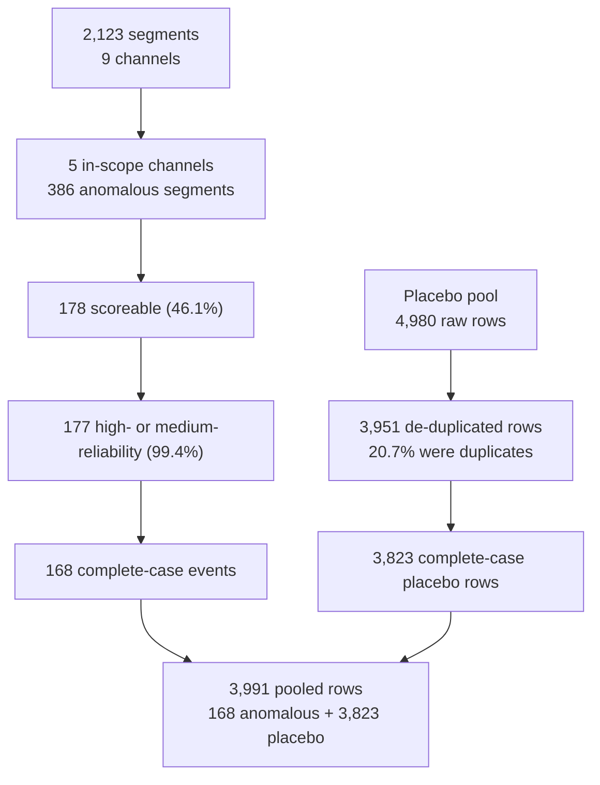

### 3.3 OPS-SAT-AD channel scope: 9 → 5

Exclusion criteria are applied in order: structural (zero anomalous segments), underpowered (fewer than 5 anomalous or fewer than 5 nominal segments), chance-level (MCC ≤ 0). The rule is conservative by construction: CADC0890 has the highest point-estimate MCC (0.83) and is still excluded, for having only 3 nominal segments.

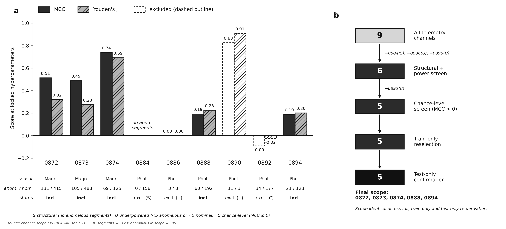

*Fig. 1. (a) MCC and Youden's J at locked BOCPD hyperparameters; dashed outlines mark excluded channels (S structural, U underpowered, C chance-level). (b) Screening funnel 9 → 6 → 5 → 5 → 5. The final scope (CADC0872, 0873, 0874, 0888, 0894) is identical in full-data, train-only and test-only re-derivations.*

**Table 3. Layer-2 channel scoping (locked hyperparameters).**

| Channel | Sensor | Anomalous / nominal | Segments | Prevalence | MCC | Youden's J | Status |
|---|---|---|---|---|---|---|---|
| CADC0872 | Magn. | 131 / 415 | 546 | 24.0% | 0.51 | 0.32 | included |
| CADC0873 | Magn. | 105 / 488 | 593 | 17.7% | 0.49 | 0.28 | included |
| CADC0874 | Magn. | 69 / 125 | 194 | 35.6% | 0.74 | 0.69 | included |
| CADC0884 | Phot. | 0 / 158 | 158 | 0.0% | n/a | n/a | excluded (S) |
| CADC0886 | Phot. | 3 / 8 | 11 | 27.3% | 0.00 | 0.00 | excluded (U) |
| CADC0888 | Phot. | 60 / 192 | 252 | 23.8% | 0.19 | 0.23 | included |
| CADC0890 | Phot. | 11 / 3 | 14 | 78.6% | 0.83 | 0.91 | excluded (U) |
| CADC0892 | Phot. | 34 / 177 | 211 | 16.1% | −0.09 | −0.02 | excluded (C) |
| CADC0894 | Phot. | 21 / 123 | 144 | 14.6% | 0.19 | 0.20 | included |

The five in-scope channels hold 386 anomalous segments (131 + 105 + 69 + 60 + 21) out of 2,123 segments in total.

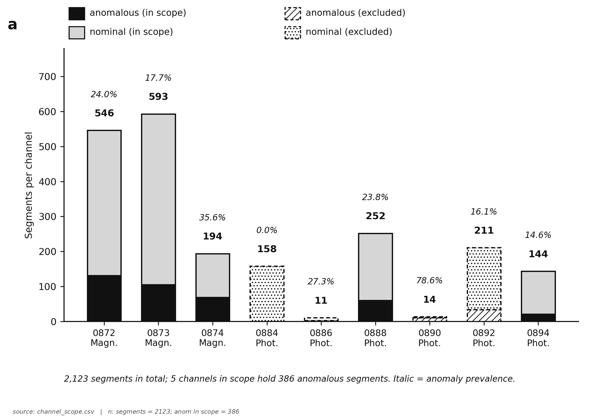

*Fig. 5. Segments per channel, split into anomalous and nominal, with anomaly prevalence in italics (2,123 segments; 386 anomalous in scope). Hatched and dotted outlines mark excluded channels. (The file name is kept for path stability; the precedence figure is Fig. 7.)*

<details>
<summary><b>Channel typing (OPS-SAT-AD): rule and Table 4</b></summary>

Channels are typed from the distribution of first differences Δ within nominal segments: `quantized` if the fraction of exact-zero Δ is at least 0.10 (step = 25th percentile of non-zero |Δ|); `float_noise_suspect` if not quantized and the smallest non-zero |Δ| is below 1×10⁻⁶; `continuous` otherwise. Thresholds are re-fitted, not reused, on SMAP/MSL and SMD.

**Table 4. Channel typing.**

| Channel | Sensor | Type | frac_zero_diff | Quantization step |
|---|---|---|---|---|
| CADC0872 | magnetometer | float_noise_suspect | 0.053 | n/a |
| CADC0873 | magnetometer | float_noise_suspect | 0.052 | n/a |
| CADC0874 | magnetometer | float_noise_suspect | 0.044 | n/a |
| CADC0884 | photodiode | quantized | 0.183 | ≈0.0144 |
| CADC0886 | photodiode | quantized | 0.371 | ≈0.0274 |
| CADC0888 | photodiode | quantized | 0.354 | ≈0.0144 |
| CADC0890 | photodiode | continuous | 0.083 | n/a |
| CADC0892 | photodiode | quantized | 0.416 | ≈0.0054 |
| CADC0894 | photodiode | quantized | 0.583 | ≈0.0026 |

Channel type maps one-to-one onto sensor family in this dataset; both are also aliased with detector-selection retention (Section 5.9).

</details>

### 3.4 Onset front end and the scoreable subset (OPS-SAT-AD)

A local-linear-trend Kalman filter absorbs a persistent mean shift into its state within a few samples and leaves a short-lived transient in the innovations, so BOCPD on the innovations is a transient-sensitive front end. It yields a scoreable window for 178 of 386 anomalous segments (46.1%): 176 high-reliability, 1 medium and 1 low (177/178 = 99.4% high-or-medium). Nine of the 177 have a non-positive pre- or post-window variance in the `diff` windows (CADC0873: 1, CADC0888: 3, CADC0894: 5), leaving **168 complete-case events** (CADC0872: 41, 0873: 28, 0874: 50, 0888: 33, 0894: 16).

> [!IMPORTANT]
> Anomalous onsets are detector-selected, whereas the default placebo pivots are position-matched resamples on normal segments. That asymmetry inflates the OPS-SAT-AD numbers. The detector-matched placebo (Section 5.5) removes it, and the resulting shrinkage is reported as an inflation term rather than hidden. OPS-SAT-AD magnitudes are read as conditional on the detector, not as benchmarks of the feature.

---

## 4. Methods

This section is a map from *method* to *module* to *output*. Full derivations are in `docs/METHODS_SUPPLEMENT.md`.

### 4.1 Pipeline map

| Stage | What it does | Module | Main output | Serves |
|---|---|---|---|---|
| Layer 1 | Signal estimation: channel typing, noise estimation, Kalman filter, shrinkage | `layer1_signal_estimation/` | standardised innovations z_t | onset front end |
| Layer 2 | Onset estimation (BOCPD) and channel scoping | `layer2_anomaly_detection/` | onset candidates, 9 → 5 channel scope | onset front end |
| Layer 3 | Signature analysis: Monte Carlo onsets, placebo tests, heterogeneity, LOO | `layer3_signature_analysis/` | effect sizes, placebo comparison (Table 21) | Q1 |
| Robustness re-analysis | Cluster-robust AUROC, small-K resampling, FAR matching and joint calibration, detector-matched placebo, tie audit, definition sensitivity, synthetic studies | `care_protocol_v8.py`, `run_pending_analyses.py`, `ress_followup_v6.py`, `ress_priority_analyses_v5.py` | Tables 7–20 | Q1–Q4 |
| Classifier-side check | 16-model cross-validation with attribution | `model_cross_validation/` | Table 23, Fig. 2 | Q2 |
| External validation | SMAP/MSL and SMD with ground-truth onsets | `external_validation/` | Tables 14, 24, 25 | Q1, Q3 |

### 4.2 Pivots, features and effect definitions

An **onset** is the first sample of an anomalous interval (SMD, SMAP/MSL) or the detector-estimated change position within a segment (OPS-SAT-AD). A **pivot** is the sample around which features are computed: onsets define anomalous pivots, and same-channel normal samples define placebo pivots, the analogue of Phase I data.

Three features are computed on windows before and after each pivot:

- `level`: the absolute standardised mean shift |d| with a pooled-SD denominator. `level_prez` uses the pre-onset standard deviation, as `diff` effectively does.
- `diff` and `diff²`: the log-variance ratio of the first-difference series and of its square,

```text
e_D = ln[ Var(z_post) / Var(z_pre) ],   z = Δx (diff)  or  z = (Δx)² (diff²)          (1)
```

For FAR-matched analyses each feature's score is the **peak over 20 post-pivot samples of the absolute series, standardised by the 20 pre-pivot samples**. In monitoring terms, `level` is a Shewhart-type location statistic and `diff`, `diff²` are successive-difference dispersion statistics.

Two hundred onset candidates per OPS-SAT-AD segment (seed 42) propagate onset uncertainty; the canonical onset is the median draw and defines the pre/post split. The default placebo is a position-matched resample of normal segments; for detector-selected onsets a detector-matched placebo is built by running the same detector on normal segments.

### 4.3 Layers 1 and 2: the OPS-SAT-AD onset front end

Observation and process noise are estimated from pooled nominal-segment differences as r = Var(Δ)/2 and q = Var(Δ²)/6. For quantised channels, step²/12 is added to the observation-noise variance. Efron–Morris-type empirical-Bayes shrinkage stabilises channels with very few nominal points (CADC0886: n = 8; CADC0890: n = 3). A Gaussian-mixture noise alternative did not improve train macro-MCC and the simple estimator was retained. A local-linear-trend Kalman filter is fitted per channel using the shrunk (r, q); standardised innovations z_t = (y_t − ŷ_t)/√S_t are the sole input to Layer 2.

BOCPD (Adams and MacKay, 2007) runs on z_t with a Normal-Inverse-Gamma conjugate predictive model, hazard rate 1/250 and a forgetting extension (κ_max = 40). Hyperparameters are locked across channels. The 2×2 ablation (mixture × forgetting) was evaluated on train macro-MCC over the six scoring channels; train-only reselection reproduces the locked combination.

**Table 5. Layer-2 ablation (train macro-MCC, 6 scoring channels).**

| Mixture | Forgetting | Train macro-MCC |
|---|---|---|
| False | True (**locked**) | **0.308** |
| True | True | 0.275 |
| False | False | 0.238 |
| True | False | 0.199 |

The five-channel scope was re-derived by bootstrap CI, by train-fit/test-evaluate and by test-only bootstrap CI; all three agree (Fig. 1b). Problem-channel diagnosis for CADC0890/0892/0894 rejected a BOCPD forgetting deficiency; a noise-model deficiency is supported for CADC0890/0894 under the mixture estimator; CADC0892 is explained by neither (steady-state kurtosis 63.32 drives spurious resets). This localises detector-tuning difficulty to channel-specific noise modelling, separately from the feature-choice question.

### 4.4 Cluster-robust AUROC (Q1, Q2)

Each dataset's onset-versus-placebo separation is estimated as an AUROC with a cluster bootstrap (1,000 resamples) at the unit within which observations repeat: segment (OPS-SAT-AD, with a channel-level check), channel (SMAP/MSL), machine (SMD; channel level as a secondary check). Paired contrasts Δ(diff − level) and Δ(diff² − level) share resamples. Because `level` falls below 0.5 in OPS-SAT-AD, a direction-agnostic variant scores `level` as max(AUC, 1 − AUC). The incremental value of `level` is measured by an out-of-fold, group-held-out logistic model on `[level, diff, diff²]` versus `[diff, diff²]`, withholding whole units.

### 4.5 Small-K resampling (Q4)

For OPS-SAT-AD (K = 5 channels) the two contrasts are re-estimated under a two-level bootstrap (channel > segment), wild-cluster bootstrap with Webb six-point and Rademacher weights (Webb, 2023; Cameron, Gelbach and Miller, 2008; MacKinnon and Webb, 2018), and exact sign-flip enumeration (2⁵ = 32 patterns) applied to the influence-function approximation of the AUROC, plus leave-one-channel-out fits. With K = 5 no exact test can reject at 0.05 (the smallest attainable two-sided p is 2/2⁵ = 0.0625), so K = 5 intervals are read as direction and magnitude.

### 4.6 Detector-matched placebo (Q4)

The stage-2 detector is run on the 996 normal segments (`partC_normal_segments_for_stage2.csv`); its detected resets (254 pivots) serve as placebo pivots, so anomalous onsets and placebo pivots are produced by the same detector. Normal-segment detection rates and anomalous retention are reported per channel.

### 4.7 FAR-matched fusion, joint calibration and grouped held-out calibration (Q3)

For each feature the alarm threshold is set to a target placebo FAR on the grid 0.5%, 1%, 2%, 5%, 10% and 20% (**1% and 5% pre-specified**). With `s_level`, `s_diff`, `s_diff²` the scores of window *i* and τ_L, τ_D, τ_D2 the thresholds, the OR-fused rule alarms when any score exceeds its threshold, and its **joint placebo FAR must not exceed the target α**:

```text
FAR_joint = (1/n0) Σ_i 1[ s_level,i > τ_L  ∨  s_diff,i > τ_D  ∨  s_diff²,i > τ_D2 ]  ≤  α          (2)
```

Thresholds are made unique by imposing a **common marginal placebo FAR q** and taking the largest q satisfying Eq. (2). Coverage is the fraction of anomalous windows alarmed.

**Grouped held-out calibration.** The 28 SMD machines are split into five folds; thresholds are fitted on training machines and applied unchanged to held-out machines, where coverage and realised FAR are measured. The split is repeated with ten random fold assignments (50 training sets); **leave-one-machine-out (LOMO)** calibration is a sensitivity check. Contrasts use machine-cluster bootstrap intervals (2,000 shared resamples). Fixed |z| > 3 rules are reported with their measured FAR rather than matched.

### 4.7a Comparators

Shewhart level, CUSUM on the mean (k = 0.5), EWMA on the mean (λ = 0.2) and I-MR (level OR moving range) were **designated as primary comparators in advance**. All are calibrated to the same joint placebo FAR with the same 20-sample Phase I window. A wider set of **26 rules** (17 single statistics, 9 OR-combined rules; 20 classical and 6 from the proposed family; 6 of the 20 classical rules contain a successive-difference component) is compared as secondary contrasts, unadjusted for multiplicity. The best-classical reference selects the highest-coverage classical rule on the evaluation data, which favours the classical side. Comparisons are **per-pivot window comparisons at matched FAR**, the quantity an alarm budget fixes; run-length (ARL) calibration is a complementary design basis that the protocol accommodates unchanged (Section 7.3).

### 4.8 The audit sequence

Every headline statistic passes through the same eight checks.

| # | Check | Result lives in |
|---|---|---|
| i | Independent from-scratch replica of the data pipeline | Table 6 |
| ii | Resampling at the higher (cluster) level | Tables 10, 12, 17 |
| iii | FAR matching over an extended grid | Table 16 |
| iv | Detector-matched placebo | Table 13 |
| v | Tie-handling audit of the precedence criterion | Tables 24, 25 |
| vi | Duplicate-pool and leakage audit | Sections 5.1, 5.10 |
| vii | Statistic-definition sensitivity | Table 15 |
| viii | Synthetic existence proof | Tables 17–19 |

### 4.9 External validation protocol

Stage 0 applies command-column exclusion, per-dataset channel re-typing, triviality filtering and a sample-size-matched design (SMAP/MSL has a median of 1 window per channel, maximum 3, so dataset-pooled and type-stratified tests are primary). Multiple comparisons use Benjamini–Hochberg FDR (1995) with a confirmatory family (dataset-pooled, 3 tests) and an exploratory family (channel-type-stratified). Stage 2 uses ground-truth onsets with an adaptive, non-sliding post-onset search window; a 150 to 5,000-sample sweep showed that the window's upper bound does not induce censoring bias (n = 40 → 41).

### 4.10 Synthetic studies

*Coverage (K = 5, 500 replications):* single-level, two-level and wild-cluster intervals against the size-weighted and channel-mean estimands. *Pooling bias (300 replications per row; K = 8, 500 replications for the endogenous-size design):* the exact pair-decomposition identity

```text
AUC_pooled = [ Σ_k n1k·n0k·AUC_k  +  Σ_{k≠l} C_kl ] / (N1·N0)
```

and simulated bias for size–effect correlation ρ ∈ {−0.8, −0.4, 0, 0.4, 0.8}. *K-sensitivity:* interval widths on SMD machine subsets.

### 4.11 Classifier-side cross-validation

Sixteen architecturally diverse models solve the binary task canonical-onset segments versus resampled placebo pivots (4,996 tabular rows; 2,733 sequence windows, 2,505 after de-duplication). Ten tabular models use the three engineered features (SHAP or permutation attribution): LogReg (L2, L1), GaussianNB, kNN, SVM (RBF), RandomForest, ExtraTrees, GradBoost, XGBoost, LightGBM. Six sequence models use per-window z-normalised three-channel series (Integrated Gradients): CNN1D, TCN, BiLSTM, BiGRU, TinyTransformer, LightMamba. A seventeenth model (MLP_shallow, AUC 0.403) was removed by the fit-quality screen. Shares are normalised within each model and compared by rank and by the 1/3 uniform reference. This check controls the classifier side only.

### 4.12 Precedence and ties (a calibration control, not a mechanism claim)

Temporal precedence records the first post-onset |z| > 3 crossing per series. Crossing times are integer sample indices, so simultaneous crossings (t_level = t_diff) are frequent. The primary analysis excludes ties; sensitivity analyses score ties as 0.5 and as `diff`-first. Intervals are cluster bootstraps (SMAP/MSL: channel, K = 63; SMD: machine, K = 28; OPS-SAT-AD: canonical pairs treated as independent, K = 237). Synthetic AR(1) series calibrate what a pure level shift produces under the criterion.

---

## 5. Results

Each subsection states the question it serves, what to look at, and how to read it.

### 5.1 Pipeline integrity gate

*Serves: all questions. Look at: the exact-match rows.*

**Table 6. Consistency gate (OPS-SAT-AD).**

| Check | Result |
|---|---|
| Replica vs saved 16-model dataset (4,996 rows) | exact row-for-row match; max relative error 1.8×10⁻¹⁵ |
| Replica vs saved canonical effect values (168 events) | max relative error 7.8×10⁻¹⁵ |
| Replica placebo pool (raw / de-duplicated) | 4,980 / 3,951 rows; matches reported counts |
| Replica re-test of the placebo-pool comparison | same significance pattern in all 15 channel × feature cells |
| Attrition funnel | 386 → 178 scoreable (46.1%) → 177 high-or-medium (99.4%) → 168 complete-case |
| Channel-level retention (scoreable / anomalous) | CADC0872 32.1% (42/131), CADC0873 27.6% (29/105), CADC0874 72.5% (50/69), CADC0888 60.0% (36/60), CADC0894 100.0% (21/21) |
| Pooled AUROC (complete-case n = 3,991) | level 0.438, diff 0.900, diff² 0.917 |
| Stratified-by-channel AUROC (Simpson check) | level 0.434, diff 0.908, diff² 0.937; no material distortion |
| Monte Carlo median vs canonical onset (level AUROC, per channel) | 0.463 vs 0.468, 0.276 vs 0.289, 0.468 vs 0.470, 0.424 vs 0.454, 0.558 vs 0.574 (raw-pool denominators); the Monte Carlo median is not the source of the `level` reversal |

**Read as:** the exact match rules out a class of end-to-end pipeline bugs (onset-index mismatch, feature-definition drift, placebo-pool corruption) as an explanation for any result below. The three magnetometer channels, which carry the strongest derivative signature, have the lowest retention for CADC0872/0873 (27.6% to 32.1%; CADC0874 is 72.5%), so instrument type is aliased with detector selectivity.

### 5.2 Q1, direction: dispersion features outrank pooled-SD `level` in 3/3 benchmarks

*Look at: the sign of every square and diamond in Fig. 6a, and how far each interval sits from 0.*

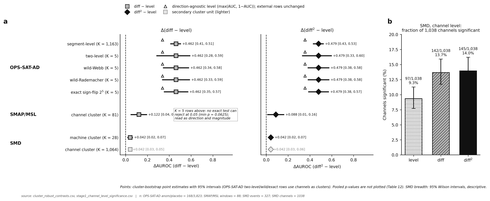

*Fig. 6. (a) Δ AUROC(diff − level) and Δ AUROC(diff² − level) with 95% cluster-bootstrap intervals. OPS-SAT-AD rows compare resampling schemes (segment, two-level, wild-Webb, wild-Rademacher, exact sign-flip 2⁵); triangles mark the direction-agnostic `level` variant. The K = 5 rows are read as direction and magnitude because no exact test can reject at 0.05 (minimum p = 0.0625). (b) SMD channel-level breadth: fraction of 1,038 channels significant per feature (Wilson 95% intervals, descriptive). Pooled p-values are not plotted (Table 14).*

**Table 7. Cluster-robust AUROC and paired contrasts (95% cluster-bootstrap CI; OPS-SAT-AD against the position-matched placebo).**

| Dataset | Cluster unit (K) | AUROC `level` | AUROC `diff` | AUROC `diff²` | Δ(diff − level) | Δ(diff² − level) |
|---|---|---|---|---|---|---|
| SMD | machine (28; 327 events) | 0.534 [0.521, 0.546] | 0.576 [0.553, 0.599] | 0.576 [0.554, 0.597] | **+0.042 [0.016, 0.066]** | **+0.042 [0.017, 0.066]** |
| SMD (reference) | channel (1,064; 327 events) | 0.534 [0.523, 0.546] | 0.576 [0.566, 0.585] | 0.576 [0.566, 0.585] | +0.042 [0.028, 0.054] | +0.042 [0.028, 0.055] |
| SMAP/MSL | channel (81; 88 windows) | 0.554 [0.497, 0.608] | 0.677 [0.600, 0.746] | 0.642 [0.568, 0.713] | **+0.122 [0.045, 0.196]** | **+0.088 [0.008, 0.164]** |
| OPS-SAT-AD | segment (1,163; 168 events) | 0.438 [0.401, 0.477] | 0.900 [0.875, 0.924] | 0.917 [0.890, 0.943] | **+0.462 [0.409, 0.508]** | **+0.479 [0.427, 0.527]** |

**Read as:** the contrast is positive in every row and its size follows the dataset: large in OPS-SAT-AD, moderate in SMAP/MSL, small in SMD. SMAP/MSL and SMD use ground-truth onsets, so the direction does not depend on an onset estimator.

**Table 8. Direction-agnostic variant.**

| Dataset | `level`, direction-agnostic | Δ(diff − level) | Δ(diff² − level) |
|---|---|---|---|
| SMD | 0.534 (unchanged) | +0.042 | +0.042 |
| SMAP/MSL | 0.554 (unchanged) | +0.122 | +0.088 |
| OPS-SAT-AD | 0.562 [0.523, 0.599] | **+0.338** | **+0.355** |

**Breadth in SMD.** At channel level, 97/1,038 channels (9.3%; Wilson 95% 7.7% to 11.3%) are significant for `level`, 142/1,038 (13.7%; 11.7% to 15.9%) for `diff` and 145/1,038 (14.0%; 12.0% to 16.2%) for `diff²`: the dispersion features flag about 1.5 times as many channels.

### 5.3 Q2, sufficiency: `level` adds no incremental discrimination

*Look at: every Δ AUROC is at or below zero.*

**Table 9. Incremental value of `level` (out-of-fold AUROC, `[level, diff, diff²]` minus `[diff, diff²]`).**

| Dataset | Δ AUROC | 95% CI | p (cluster bootstrap) |
|---|---|---|---|
| SMD (machine) | −0.0009 | [−0.0143, 0.0129] | 0.93 |
| SMAP/MSL (channel) | −0.0068 | [−0.0381, 0.0241] | 0.70 |
| OPS-SAT-AD (segment) | −0.0007 | [−0.0014, −0.0001] | 0.03 |

**Read as:** `level` contributes no positive incremental discrimination in any benchmark; the OPS-SAT-AD change (|Δ| < 0.001) is negligible in size. These intervals are not equivalence tests; the SMD and SMAP/MSL results bound any possible gain at about 0.01 and 0.02 AUROC. For a site, the practical question is therefore not which new statistic to adopt but how to share one false-alarm budget between the level chart already deployed and a successive-difference channel (Section 5.7).

### 5.4 Q4, small K: what survives when the channel is the unit

*Look at: Fig. 3a (channel-level `level` AUROCs), the bottom half of Fig. 3a (pooled interval by scheme), and Fig. 3b (slice replication).*

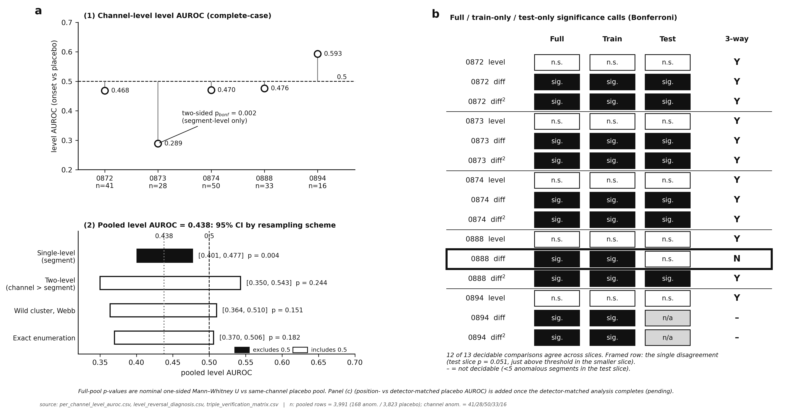

*Fig. 3. (a) Channel-level `level` AUROC (complete-case) and pooled AUROC 0.438 with 95% intervals under four resampling schemes. (b) Full / train-only / test-only significance calls (Bonferroni): 12 of 13 decidable calls agree; the single disagreement (CADC0888 `diff`, test-slice p = 0.051) is a monotone power loss. (c) Position-matched (open circle) versus detector-matched (filled, 95% CI) placebo; normal-segment detection rate / anomalous retention: 0872 18%/31%, 0873 22%/28%, 0874 30%/72%, 0888 99%/60%, 0894 88%/100%.*

**Table 10. Δ AUROC under alternative resampling schemes (OPS-SAT-AD, position-matched placebo).**

| Scheme | Unit (K) | Δ(diff − level) [95% CI] | Δ(diff² − level) [95% CI] |
|---|---|---|---|
| Point estimate | n/a | +0.462 | +0.479 |
| Single-level bootstrap | segment (1,163) | [0.409, 0.508] | [0.427, 0.527] |
| Two-level bootstrap | channel > segment (5) | [0.282, 0.593] | [0.327, 0.600] |
| Wild cluster, Webb 6-point | channel (5) | [0.342, 0.582] | [0.379, 0.578] |
| Wild cluster, Rademacher | channel (5) | [0.334, 0.590] | [0.380, 0.578] |
| Exact sign-flip enumeration (2⁵ = 32) | channel (5) | [0.350, 0.574] | [0.384, 0.574] |

Single-level interval widths are 0.099 (`diff`) and 0.100 (`diff²`); two-level widths are 0.311 and 0.273 (2.7 to 3.1 times wider). **Both contrasts keep their sign and size under every scheme.** Leave-one-channel-out fits preserve the sign as well:

**Table 11. Leave-one-channel-out (OPS-SAT-AD).**

| Channel dropped | AUROC `level` | Δ(diff − level) | Δ(diff² − level) |
|---|---|---|---|
| none (full) | 0.438 | 0.462 | 0.479 |
| CADC0872 | 0.426 | 0.448 | 0.476 |
| CADC0873 | 0.486 | 0.390 | 0.417 |
| CADC0874 | 0.437 | 0.475 | 0.489 |
| CADC0888 | 0.433 | 0.495 | 0.494 |
| CADC0894 | 0.415 | 0.490 | 0.513 |

Pooled `level` moves toward 0.5 only when CADC0873 is removed.

**Table 12. Pooled `level` AUROC (0.438) under the same schemes.**

| Scheme | 95% CI | p vs 0.5 | Excludes 0.5 |
|---|---|---|---|
| Single-level (segment) | [0.401, 0.477] | 0.004 | yes |
| Two-level (channel > segment) | [0.350, 0.543] | 0.244 | no |
| Wild cluster, Webb | [0.364, 0.510] | 0.151 | no |
| Exact enumeration | [0.370, 0.506] | 0.125 | no |

(p-values use the count-based (b + 1)/(B + 1) correction; the enumeration p is count-based, not a permutation test.)

**Read as:** the dispersion-over-level contrast is robust to the resampling unit; the pooled `level` reversal is not. It is significant only when segments are treated as the independent unit, and is indistinguishable from chance under channel-level resampling. Channel-level `level` AUROCs are 0.468, 0.289, 0.470, 0.476 and 0.593 for CADC0872, 0873, 0874, 0888 and 0894 (n = 41, 28, 50, 33, 16). `level` in OPS-SAT-AD is therefore read as **inconclusive**, neither for nor against discrimination.

### 5.5 Q4, the reference: detector-matched placebo and selection inflation

*Look at: Fig. 3c. Open circles are the position-matched placebo values; filled markers with intervals are detector-matched.*

**Table 13. Onset-versus-placebo AUROC by placebo type (OPS-SAT-AD, pooled).**

| Feature | Position-matched | Detector-matched (95% CI) |
|---|---|---|
| `level` | 0.438 | 0.382 [0.327, 0.441]; direction-agnostic 0.618 |
| `diff` | 0.900 | **0.569 [0.518, 0.626]** |
| `diff²` | 0.917 | **0.720 [0.675, 0.769]** |

Per channel, `diff` under the detector-matched placebo falls to 0.136 in CADC0888 and 0.314 in CADC0894 (Fig. 3c); these are the two channels where the detector fires on 99% and 88% of normal segments. Detector-matched placebo counts are 254 pivots.

**Read as:**

- Both dispersion features stay above 0.5 against a detector-produced reference; the magnitude is much smaller than the position-matched value.
- `diff²` remains above the direction-agnostic `level` (0.720 versus 0.618); `diff` does not (0.569 versus 0.618).
- OPS-SAT-AD is a **case study whose magnitude is detector-conditioned**, and the selection-conditioned difference enters the ledger as an inflation term (Table 26). Detector-matched intervals are segment-level, so between-channel uncertainty is not reflected here (Section 7.1).

### 5.6 Q1 (external), replication and the definition of `level`

*Look at: how the pooled nominal tests compare with the calibrated cluster intervals of Table 7, and how much of the external `diff` advantage is definitional.*

**Table 14. Placebo-pool comparison across datasets (pooled p-values are nominal one-sided tests; windows are nested in channels and machines, so Table 7 is the calibrated comparison).**

| Dataset | Scope | `level` | `diff` | `diff²` |
|---|---|---|---|---|
| SMD | dataset-pooled (11,493 windows ≈ 327 events × ≤ 38 dimensions) | p_fdr = 8×10⁻³⁸ | p_fdr = 3.7×10⁻¹⁶⁷ | p_fdr = 1.4×10⁻¹⁶⁶ |
| SMAP/MSL | dataset-pooled (88 windows) | p_fdr = 0.031 | p_fdr = 4.7×10⁻⁹ | p_fdr = 1.3×10⁻⁶ |
| OPS-SAT-AD | channel-level (n = 5) | 0/5 significant | 5/5 (all p < 2×10⁻⁴) | 5/5 (all p < 2×10⁻⁴) |

Outside OPS-SAT-AD, `level` carries a small component above placebo in the pooled test. In SMAP/MSL its channel-cluster interval includes 0.5 (0.554 [0.497, 0.608]), so the component is weak there; it is small but reliable in SMD (0.534 [0.521, 0.546]). `float_noise_suspect` cannot be tested in SMAP/MSL (1 of 82 channels, 3 windows) and shows no significant effect for any feature in SMD (162 windows across 17 channels), so the instrument-type moderator is untestable externally.

**Table 15. Statistic-definition sensitivity: `level` with pooled-SD versus pre-onset-SD denominator (`level_prez`).**

| Dataset | Increase in `level` AUROC with `level_prez` | Δ(diff − level), pooled SD | Δ(diff − level_prez) | p |
|---|---|---|---|---|
| SMD | +0.035 | +0.042 | +0.010 | 0.50 |
| SMAP/MSL (68 channels) | +0.080 | +0.122 (81 ch.); +0.140 (68 ch.) | +0.060 | 0.22 |
| OPS-SAT-AD | not an explanation for the reversal | +0.462 | +0.447 | ≤ 0.002 |

For the 68 SMAP/MSL channels where `level_prez` is available the pooled-SD contrast is +0.140, equal to the `level_prez` contrast plus the `level` AUROC increase (0.060 + 0.080).

**Read as:** part of the external dispersion advantage is definitional. When `level` is standardised by the pre-onset SD, as `diff` effectively is, the two features are not distinguishable in SMD and SMAP/MSL (positive point estimates) and `diff` stays clearly ahead only in OPS-SAT-AD. Together with Table 9, this frames the dispersion channel as **complementary and sufficient**, not as uniformly superior.

### 5.7 Q3, operating value at a matched false-alarm rate

*Look at: Fig. 6c panels (a, c) for SMD. Panels (b, d) show a 56-window sample whose gain changes sign across targets.*

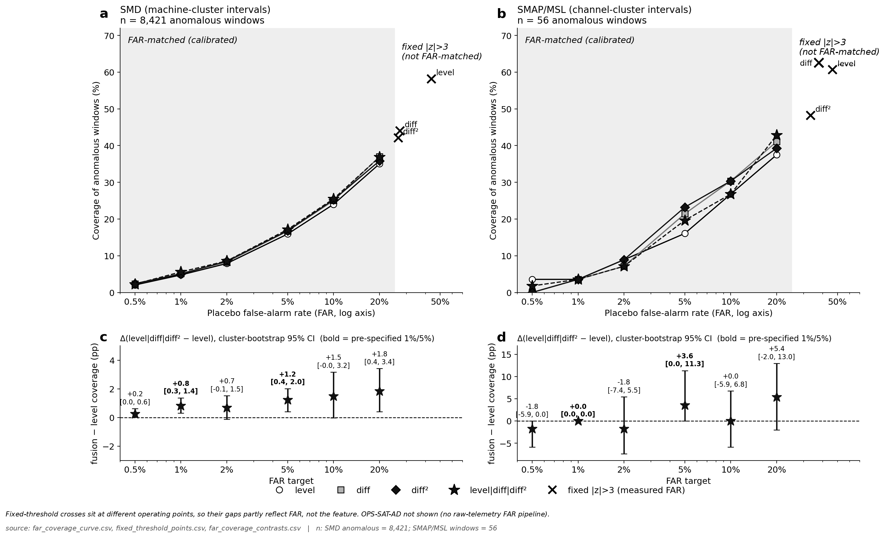

*Fig. 6c. (a, c) SMD, n = 8,421 anomalous windows, machine clusters: fusion-minus-`level` coverage (percentage points) under in-sample (stars), five-fold × 10 held-out (circles) and leave-one-machine-out (squares) calibration, with 95% machine-cluster intervals. (b, d) SMAP/MSL, n = 56 windows, channel clusters, in-sample only. Shaded: pre-specified 1% and 5% targets (not a significance mark). OPS-SAT-AD is not shown (no raw-telemetry FAR pipeline).*

**Table 16. Fusion-minus-`level` coverage at matched placebo FAR (percentage points; cluster-bootstrap 95% CI).**

| FAR target | SMD in-sample | SMD held-out (5-fold × 10) | SMD held-out (LOMO) | Realised held-out FAR, % (fusion / level) | SMAP/MSL in-sample (n = 56) |
|---|---|---|---|---|---|
| 0.5% | +0.29 [−0.05, 0.80] | +0.31 [0.04, 0.73] | +0.37 [0.01, 0.89] | 0.55 / 0.55 | −1.8 [−5.9, 0.0] |
| **1%** | **+0.86 [0.31, 1.62]** | **+0.66 [0.11, 1.41]** | **+0.78 [0.25, 1.51]** | 1.07 / 1.07 | 0.0 [0.0, 0.0] |
| 2% | +0.75 [−0.03, 1.74] | +0.70 [−0.04, 1.67] | +0.82 [0.04, 1.81] | 2.07 / 2.08 | −1.8 [−7.4, 5.5] |
| **5%** | **+1.22 [0.32, 2.25]** | **+1.29 [0.43, 2.33]** | **+1.28 [0.35, 2.43]** | 5.04 / 5.02 | +3.6 [0.0, 11.3] |
| 10% | +1.50 [−0.10, 3.43] | +1.57 [0.07, 3.41] | +1.47 [−0.08, 3.32] | 10.03 / 10.01 | +0.0 [−5.9, 6.8] |
| 20% | +1.79 [0.33, 3.59] | +1.70 [0.13, 3.58] | +1.84 [0.35, 3.67] | 20.03 / 20.03 | +5.4 [−2.0, 13.0] |

*The zero-width SMAP/MSL interval at 1% reflects discrete coverage. The machine-cluster interval of the pooled realised FAR at the 5% target (3.6% to 6.8%) reflects between-machine heterogeneity and is an interval for the pooled rate, not a range of machine-level rates.*

**Read as:**

- At 5% FAR, coverage rises from 16.1% (`level`) to 17.4% (fusion), a held-out gain of **+1.3 pp (95% CI 0.4 to 2.3)**, against +1.2 pp in-sample and +1.3 pp under LOMO. In relative terms this is about 8% more detections at an unchanged false-alarm burden, or about **13 additional detected anomalous windows per 1,000 (95% interval 4 to 23)**.
- In-sample and held-out gains agree at 5% (difference 0.1 pp, CI −0.2 to 0.4). At 1% the held-out gain is slightly smaller than in-sample (−0.19 pp, −0.40 to −0.03), a mildly conservative transfer.
- The gain is positive at all six targets under all three designs (+0.3 to +1.8 pp). Held-out intervals exclude zero at five of six targets under both five-fold and LOMO calibration, including both pre-specified targets.
- Realised held-out FAR exceeds the target by only 0.03 to 0.07 points and differs between fusion and level by at most 0.02 points.
- SMAP/MSL (56 windows) supports direction but not a matched-FAR ranking: point estimates change sign across targets, and the 5% estimate's interval reaches zero. It is reported descriptively.

**Table 16a. Sensitivity of grouped held-out calibration to the fold assignment (SMD, fused rule, 5% FAR unless stated).**

| Quantity | In-sample | Held-out min | Held-out max | Mean (SD) |
|---|---|---|---|---|
| Common marginal level q | 0.0372 | 0.0352 | 0.0384 | 0.0371 (0.0009) |
| τ_level | 13.17 | 12.02 | 14.57 | 13.21 (0.66) |
| τ_diff | 9.99 | 9.18 | 10.96 | 10.05 (0.54) |
| τ_diff² | 9.52 | 8.88 | 10.50 | 9.66 (0.46) |
| Fusion − level coverage, 5% FAR (pp; 10 repeats) | 1.22 | 1.09 | 1.48 | 1.29 (0.12) |
| Fusion − level coverage, 1% FAR (pp; 10 repeats) | 0.86 | 0.49 | 0.76 | 0.66 (0.08) |

Threshold rows summarise the 50 training sets (five folds × ten assignments); coverage rows summarise the 10 repeats. Individual thresholds vary by about ±10% around their means, with in-sample thresholds inside these ranges.

**Table 16b. Fused rule minus comparator, coverage at matched placebo FAR (percentage points; SMD; machine-cluster bootstrap 95% CI; all rules calibrated in-sample on the same windows).**

| Comparator | 5% FAR | 1% FAR |
|---|---|---|
| Shewhart level | +1.20 [0.34, 2.17] | +0.86 [0.31, 1.59] |
| CUSUM on the mean (k = 0.5) | +3.54 [1.89, 5.36] | −0.08 [−0.98, 0.88] |
| EWMA on the mean (λ = 0.2) | +1.63 [0.28, 3.12] | −0.10 [−0.70, 0.65] |
| **I-MR (level OR moving range)** | **−0.08 [−0.70, 0.49]** | +0.34 [0.08, 0.70] |
| CUSUM sequential analogue (mean + difference variance) | +0.87 [−0.07, 1.86] | −0.82 [−1.71, −0.05] |

The first four rows are the pre-designated primary comparators; the last row and the hybrid contrasts below are secondary and unadjusted for multiplicity. The extended set (26 rules, with dual-chart, EWMA-analogue, AR(1)-residual and hybrid contrasts) is tabulated in the supplementary material (S3 / Table S5 of the manuscript).

**Read as:**

- At 5% FAR the fused rule exceeds the CUSUM chart on the mean by 3.5 pp (1.9 to 5.4) and the EWMA chart by 1.6 pp (0.3 to 3.1), and it **matches I-MR** (−0.1 pp, −0.7 to 0.5). At 1% FAR, where every rule covers only 5% to 6.5%, the variants lie within about one point; I-MR trails the fused rule by 0.3 pp.
- What separates rules is whether a successive-difference statistic is present and jointly calibrated, not the chart family: adding `diff` and `diff²` to a CUSUM or EWMA mean chart raises coverage by **+2.6 pp (1.2 to 4.1)** and **+1.4 pp (0.2 to 2.7)** at 5% FAR, and the twelve highest-coverage rules among the 26 all contain a successive-difference statistic (best rule without one: 16.1%, versus 17.1% to 17.2% for the three leaders).
- **Deployable reading:** a site that runs I-MR charts can capture the gain at 5% FAR by calibrating its two charts on one joint false-alarm budget; no new statistic is required.
- The classical comparators are calibrated in-sample; grouped held-out calibration is applied to the fused rule and `level` only (Section 7.1).

> [!IMPORTANT]
> Fixed |z| > 3 has a placebo FAR of 43.7% (`level`) and 27.2% (`diff`) in SMD and 46.4% and 37.8% in SMAP/MSL. Such a rule buys apparent coverage at roughly one nuisance alarm for every two to four normal pivots, so gaps between fixed-threshold rules partly reflect the operating point, not the feature. Compare rules only at a stated, matched FAR.

**Adoption inequality.** Because matched comparison fixes the burden per normal pivot, adopting an extra channel reduces to Δcoverage × π × c_miss > c_channel, where π is the number of anomalous pivots per period, c_miss the cost of a missed detection and c_channel the cost of the channel per period; the interval for Δcoverage carries over directly.

### 5.8 Q4, the estimand decides the resampling unit; pooling can bias

*Look at: Fig. 6b(a), where only one procedure falls well below the nominal band, and Fig. 6b(b), where only the pooled estimate moves.*

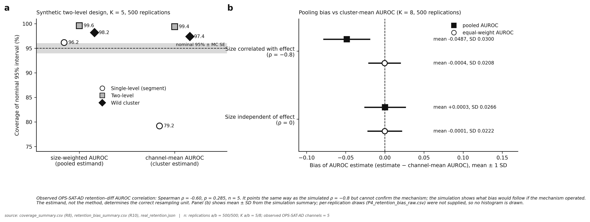

*Fig. 6b. (a) Coverage of nominal 95% intervals for the size-weighted (pooled) and channel-mean (cluster) estimands in a synthetic two-level design (K = 5, 500 replications). (b) Bias of pooled and equal-weight AUROC relative to the channel-mean AUROC when cluster size correlates with effect size (ρ = −0.8) or is independent (ρ = 0); K = 8, 500 replications; mean ± 1 SD.*

**Table 17. Coverage of 95% intervals (K = 5, 500 replications, MC SE ≈ 0.010).**

| Procedure | Coverage, size-weighted target | Coverage, channel-mean target | Mean width |
|---|---|---|---|
| Single-level (segment) | 96.2% | **79.2%** | 0.066 |
| Two-level | 99.6% | 99.4% | 0.188 |
| Wild cluster | 98.2% | 97.4% | 0.163 |

The single-level interval is near nominal for the pooled estimand and under-covers the channel-mean estimand; channel-level procedures cover both but are conservative. **The appropriate resampling unit is determined by the estimand.**

**Table 18. Pooled versus equal-weight AUROC (300 replications per row).**

| Size–effect correlation ρ | Mean (pooled − equal-weight) | SD |
|---|---|---|
| −0.8 | −0.0488 | 0.031 |
| −0.4 | −0.0245 | 0.032 |
| 0.0 | +0.0003 | 0.030 |
| +0.4 | +0.0224 | 0.031 |
| +0.8 | +0.0469 | 0.029 |

The pair-decomposition identity holds to 0 (pooled) and 2.8×10⁻¹⁷ (weighted-mean versus covariance form) on test data and is enforced by `layer3_signature_analysis/tests/test_pooled_identity.py`; the sign of the simulated bias matches the identity in 5/5 conditions.

**Table 19. Endogenous cluster size (retention) and pooled-AUROC bias (K = 8, 500 replications).**

| Mechanism | Pooled bias (mean, SD) | Equal-weight bias (mean, SD) |
|---|---|---|
| Size correlated with effect (ρ = −0.8) | −0.0487 (0.0300) | −0.0004 (0.0208) |
| Size independent of effect | +0.0003 (0.0266) | −0.0001 (0.0222) |

The observed OPS-SAT-AD retention versus `diff` AUROC gives Spearman ρ = −0.60 (exact permutation p = 0.35; n = 5); the retention-weighted mean `diff` AUROC is 0.864 versus 0.885 equal-weight. The observed correlation has the sign of the simulated mechanism; with n = 5 it is compatible with, but does not establish, that mechanism.

**Table 20. K-sensitivity of interval widths (SMD machine subsets; descriptive).**

| K (machines) | Reps | Width single | Width hierarchical | Ratio hier/single | Ratio wild/single |
|---|---|---|---|---|---|
| 5 | 20 | 0.082 | 0.148 | 1.79 | 1.22 |
| 12 | 20 | 0.067 | 0.113 | 1.68 | 1.10 |
| 20 | 20 | 0.065 | 0.102 | 1.57 | 0.90 |
| 28 | 1 | 0.064 | 0.090 | 1.41 | 0.80 |

The hierarchical/single ratio decreases with K (log–log slope −0.11, p = 0.004) and remains about 1.4 at K = 28. Subsets overlap and K = 28 is a single full-data replicate, so this is a descriptive trend.

### 5.9 Supporting evidence (OPS-SAT-AD): placebo pool, slice replication, heterogeneity

*Serves: Q1. Collapsed because these results support, and do not carry, the headline claims.*

<details>
<summary><b>Placebo-pool comparison and train/test slice replication (Table 21)</b></summary>

**Table 21. Placebo-pool comparison (OPS-SAT-AD, raw placebo pool, one-sided Mann–Whitney, Bonferroni over 15 tests).**

| Feature | Channels significant | Significant-segment fraction |
|---|---|---|
| `level` | 0/5 (p_bonf capped at 1.000) | 54% to 92% within-segment (pre/post test) |
| `diff` | 5/5 (all p_bonf < 2×10⁻⁴) | magnetometers 0.78 to 0.89; photodiodes 0.12 to 0.42 |
| `diff²` | 5/5 (all p_bonf < 2×10⁻⁴) | magnetometers 0.78 to 0.89; photodiodes 0.12 to 0.42 |

A p_bonf of 1.000 for `level` is the Bonferroni cap (raw p × 15 ≥ 1) and is read as no detectable excess over placebo; no equivalence test was run. The de-duplicated pool (3,951 rows) changes p-values by at most a factor of about three and no significance call. Train-only reproduction (178,504 of 240,979 rows, 74.1%; 126 anomalous segments) matches full data in 15/15 calls; test-only reproduction (62,475 rows, 25.9%; 51 anomalous segments) matches in 12/13 decidable calls, with one borderline (CADC0888 `diff`, p = 0.051) and two not decidable (CADC0894, n = 4 < 5).

Within-segment significance shows that `level` is significant in 54% to 92% of segments per channel and `diff`/`diff²` in 2% to 76%. Temporal-profile classification reconciles this with the precedence test: `diff` is transient in 98% of segments, `diff²` in 94%, and `level` is a near-even mix (50%/45%); the `level` significance rate falls from 0.864 to 0.633 in the early window, a larger relative loss than for `diff`/`diff²`.

</details>

<details>
<summary><b>Between-channel heterogeneity (Fig. 4, Table 22)</b></summary>

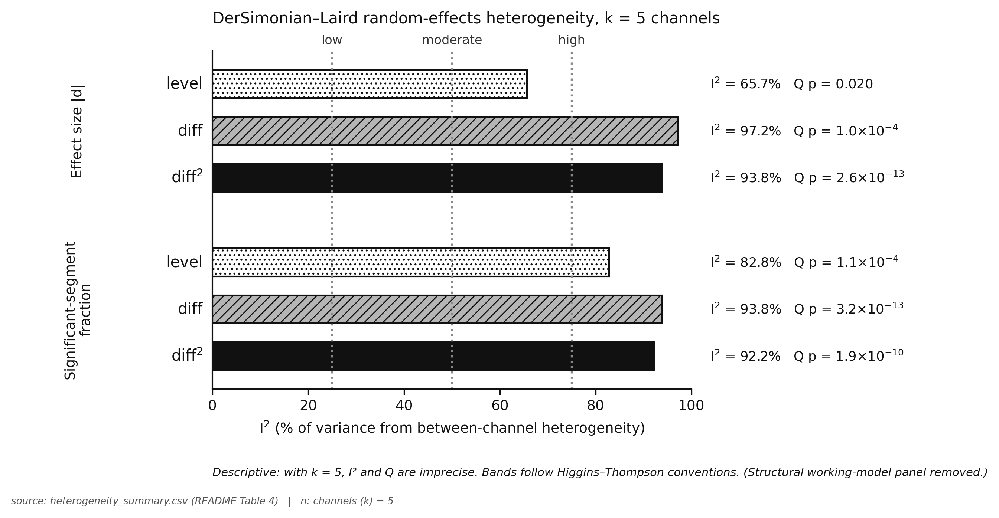

*Fig. 4. Random-effects heterogeneity, k = 5 channels, for effect size |d| (top) and significant-segment fraction (bottom). Bands follow Higgins–Thompson conventions; with k = 5, I² and Q are descriptive. (The file name is kept for provenance; the figure shows the I² panel only.)*

**Table 22. Between-channel heterogeneity (DerSimonian–Laird, k = 5).**

| Statistic | Feature | I² | Q p |
|---|---|---|---|
| Effect size \|d\| | `level` | 65.7% | 0.020 |
| Effect size \|d\| | `diff` | 97.2% | 1.0×10⁻⁴ |
| Effect size \|d\| | `diff²` | 93.8% | 2.6×10⁻¹³ |
| Significant-segment fraction | `level` | 82.8% | 1.1×10⁻⁴ |
| Significant-segment fraction | `diff` | 93.8% | 3.2×10⁻¹³ |
| Significant-segment fraction | `diff²` | 92.2% | 1.9×10⁻¹⁰ |

Leave-one-out decomposition localises the heterogeneity: removing CADC0872 eliminates all `level`-|d| heterogeneity, removing CADC0874 eliminates all `diff²`-|d| heterogeneity, and removing CADC0894 nearly halves the pooled `diff`/`diff²` significance fraction. The magnetometer-over-photodiode pattern is aliased with channel type and with detector retention (28% to 100%), and `diff` reverses in the two photodiode channels under detector matching. It is stated as a **hypothesis** for instrument-level work (rule R8), not as a finding.

</details>

### 5.10 Supporting evidence: classifier-side robustness and leakage audit

*Serves: Q2. Collapsed; the attribution counts are descriptive because models share data and labels.*

<details>
<summary><b>Sixteen models, three training protocols (Fig. 2, Table 23)</b></summary>

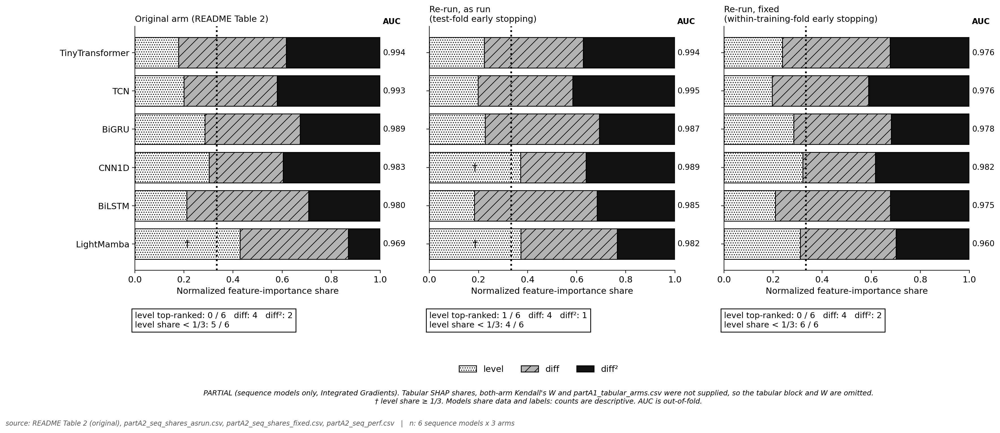

*Fig. 2. Normalised feature-importance shares (Integrated Gradients) for the six sequence models in the original arm, the re-run with test-fold early stopping (superseded protocol), and the re-run with within-training-fold early stopping (reported protocol). † marks `level` share ≥ 1/3; the dotted line is the 1/3 uniform reference. Models share data and labels, so counts are descriptive; AUC is out-of-fold. This supplementary figure covers the sequence models only; the tabular block is summarised in the text below.*

**Table 23. Sequence-model arm by training protocol (6 models).**

| Protocol | `level` top-ranked | `diff` top | `diff²` top | `level` share < 1/3 | Out-of-fold AUC range |
|---|---|---|---|---|---|
| Original arm | 0/6 | 4 | 2 | 5/6 | 0.969 to 0.994 |
| Re-run, test-fold early stopping (superseded) | 1/6 (CNN1D) | 4 | 1 | 4/6 | 0.982 to 0.995 |
| Re-run, within-training-fold early stopping (reported) | 0/6 | 4 | 2 | 6/6 | 0.960 to 0.982 |

In the original 16-model arm, 0/16 models rank `level` first (`diff` first in 5, `diff²` in 11; binomial reference (2/3)¹⁶, p = 0.0015, descriptive); tabular 0/10, sequence 0/6; 15/16 give `level` less than 1/3 (the exception is LightMamba, 0.428). Kendall's *W* = 0.609 (χ² = 19.50, df = 2, p = 5.8×10⁻⁵) for the original arm; bootstrap stability over 200 resamples favours `diff`+`diff²` over `level` in 100% of resamples for RandomForest and LogisticRegression. With three features, "`diff` + `diff²` > `level`" is expected 2:1 under a uniform-share null, so the informative quantities are the top-rank count and the size of the `level` share.

The tabular dataset was re-derived from raw time series (exact match) and re-run with a de-duplicated placebo pool, multi-seed stratified-group CV and a row-level CV as a leakage positive control (AUC moves by at most 0.017; positive control |Δ| ≤ 0.009, non-systematic). Under the within-training-fold protocol (60 epochs) no sequence model ranks `level` first, whereas under test-fold early stopping CNN1D does (0.371 versus 0.362 for `diff²`). The result is reported as ledger entry L8 because it shows that a protocol decision can change a count of this kind, not as a general claim about attribution.

</details>

### 5.11 Supporting evidence: temporal precedence and tie handling

*Serves: Q4. Collapsed; this analysis is a calibration control, not evidence for a variance-surge mechanism.*

<details>
<summary><b>Precedence with ties excluded, and the tie-handling audit (Fig. 7, Tables 24 and 25)</b></summary>

Crossing times are integer sample indices, so simultaneous crossings occur in 45% / 33% of SMAP/MSL anomalous / normal pairs and 66% / 61% of SMD pairs (33% to 66% overall). The primary analysis excludes ties.

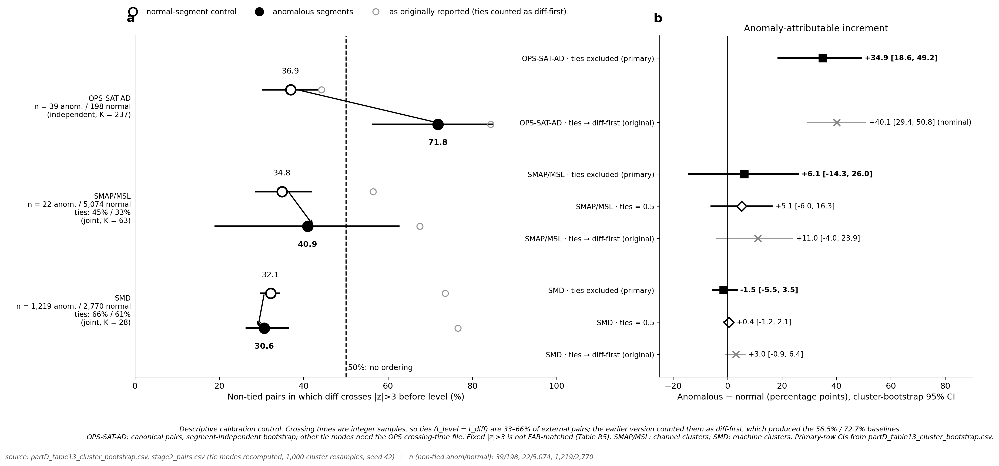

*Fig. 7. (a) Non-tied pairs in which `diff` crosses |z| > 3 before `level`, anomalous versus normal control; small open circles show the originally reported values (ties counted as `diff`-first). (b) Anomalous-minus-normal increment in percentage points with cluster-bootstrap 95% intervals under three tie conventions.*

**Table 24. Precedence ordering and normal-control baseline (ties excluded; 95% cluster CI).**

| Dataset | Regime | n pairs | `diff` precedes `level` |
|---|---|---|---|
| OPS-SAT-AD | anomalous | 39 | 71.8% [56.4, 84.6] |
| OPS-SAT-AD | normal control | 198 | 36.9% [30.3, 43.4] |
| SMAP/MSL | anomalous | 22 | 40.9% [19.0, 62.5] |
| SMAP/MSL | normal control | 5,074 | 34.8% [28.7, 41.7] |
| SMD | anomalous | 1,219 | 30.6% [26.4, 36.3] |
| SMD | normal control | 2,770 | 32.1% [29.9, 34.2] |

**Table 25. Increment (anomalous − normal), percentage points, with tie-handling sensitivity.**

| Dataset | Primary: ties excluded | Ties = 0.5 | Ties → `diff`-first |
|---|---|---|---|
| OPS-SAT-AD | **+34.9 [18.6, 49.2]** (p_boot = 0.002) | not computed | +40.1 [29.4, 50.8] (nominal) |
| SMAP/MSL | **+6.1 [−14.3, 26.0]** (p_boot = 0.64) | +5.1 [−6.0, 16.3] | +11.0 [−4.0, 23.9] |
| SMD | **−1.5 [−5.5, 3.5]** (p_boot = 0.49) | +0.4 [−1.2, 2.1] | +3.0 [−0.9, 6.4] |

With ties excluded, `diff` precedes `level` in fewer than half of non-tied pairs at placebo pivots in all three datasets (32% to 37%); counting ties as `diff`-first produced baselines of 44.2%, 56.5% and 72.7% (OPS-SAT-AD, SMAP/MSL, SMD). Only the OPS-SAT-AD increment excludes zero; in the external datasets the increment is not distinguishable from zero and, in SMD, changes sign with the convention.

The criterion has limited diagnostic power: it uses a fixed |z| > 3 threshold whose placebo FAR is 27% to 46%, it conditions on pairs where both features cross, and in synthetic AR(1) series with φ ≥ 0.8 a *pure level shift* already yields `diff`-first in 74% to 92% of pairs. It is therefore used as a calibration control (R7) and not as evidence for a variance-surge mechanism.

Pair counts follow the canonical-pair rule. The original pairing rule gives 70/224 (`level` vs `diff`), 70/171 (`level` vs `diff²`) and 161/211 (`diff` vs `diff²`); there the `diff` versus `diff²` sign fraction (92.5% vs 35.5%) and the signed-rank test (p = 0.368) disagree, so no claim rests on that comparison.

</details>

---

## 6. Alarm design playbook and inflation ledger

### 6.1 Findings

| # | Finding | Question | Where |
|---|---|---|---|
| F1 | **Direction.** Dispersion features separate labelled onsets from same-channel placebo pivots better than pooled-SD `level` in every benchmark, stable across resampling units and K. Two of three onset sources are ground-truth labels, so the direction does not depend on an onset estimator. Against a pre-onset-SD `level` the gap closes in SMD and SMAP/MSL. | Q1 | Tables 7, 15 |
| F2 | **Sufficiency.** Once `diff`/`diff²` are present, `level` adds no out-of-fold discrimination in any benchmark. | Q2 | Table 9 |
| F3 | **Operating value is a calibration result.** Under one joint placebo FAR, the fused rule adds +1.3 pp held-out coverage at 5% FAR in SMD, and I-MR matches it. | Q3 | Tables 16, 16b |
| F4 | **Evaluation sensitivity.** The size of an apparent advantage depends on the placebo, the resampling unit, the statistic definition and the tie convention. | Q4 | Table 26 |

### 6.2 The inflation ledger

**Table 26. Evaluation choices and their effect on the apparent advantage (L1–L8).**

| Entry | Inflates | Naive reading | Corrected reading | Evidence |
|---|---|---|---|---|
| L1 Placebo selection (OPS-SAT-AD) | Effect size | `diff` 0.900, `diff²` 0.917 | `diff` 0.569 [0.518, 0.626]; `diff²` 0.720 [0.675, 0.769] | Real data (Table 13, Fig. 3c) |
| L2 Direction of `level` | Effect size | Δ(diff − level) = +0.462 | direction-agnostic: +0.338 | Real data (Table 8, Fig. 6a) |
| L3 Resampling unit | Certainty (p, CI) | `level` 0.438 [0.401, 0.477], p = 0.004 | [0.350, 0.543], p = 0.244 (two-level) | Real data (Table 12, Fig. 3a) |
| L4 Interval width of the contrast | Certainty (CI width) | 0.099 (segment) | 0.311 (two-level), 2.7 to 3.1 times as wide | Real data (Table 10) |
| L5 Statistic definition of `level` | Effect size | +0.140 (SMAP/MSL, 68 ch.), +0.042 (SMD) | +0.060 (p = 0.22), +0.010 (p = 0.50) | Real data (Table 15) |
| L6 Tie handling in precedence | Reference rate | baselines 44.2 / 56.5 / 72.7% | 36.9 / 34.8 / 32.1% | Real data, three datasets (Table 24, Fig. 7) |
| L7 Pooling versus equal weighting | Bias | pooled bias −0.049 at ρ = −0.8 | ≈ 0 at ρ = 0; equal-weight bias ≈ 0 in both designs | Synthetic (Tables 18, 19, Fig. 6b) |
| L8 Training protocol (sequence models) | Count | 1/6 rank `level` first (test-fold early stopping) | 0/6 (within-training-fold early stopping) | Descriptive, n = 6 (Table 23, Fig. 2) |

Tie baselines are ordered OPS-SAT-AD, SMAP/MSL, SMD. The sign of the dispersion advantage over `level` is retained under the resampling-unit and direction-agnostic corrections; under pre-onset-SD standardisation (SMD, SMAP/MSL) and under a detector-matched placebo (OPS-SAT-AD `diff`) the gap narrows. The ledger is the transferable part of this repo: it does not say the dispersion channel loses; its direction survives every correction, and what shrinks is the size of the advertised gap.

### 6.3 Alarm design playbook (rules R1–R8)

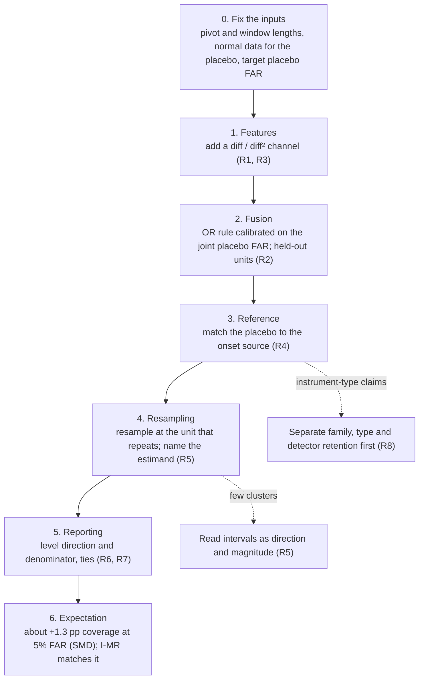

**Table 27. Design and reporting rules that follow from the evidence (associational).**

| # | Rule | Guards against | Evidence |
|---|---|---|---|
| R1 | Add a successive-difference dispersion channel (`diff`, `diff²`, or a moving-range chart where one is in use) and evaluate its incremental value at a matched FAR. | Definition-driven advantage | Tables 7, 15, 16b |
| R2 | Combine features with an OR rule calibrated on the joint placebo FAR; fit on training units; report coverage and realised FAR on held-out units. | Hidden operating point | Table 16; fixed \|z\| > 3 has FAR 27% to 46% |
| R3 | Test the incremental value of `level` out of fold, grouped by unit, before including it. | Spurious sufficiency | Table 9 |
| R4 | Use a placebo produced by the same detector when onsets are detector-selected. | Selection asymmetry | Table 13, Fig. 3c |
| R5 | Resample at the unit that repeats and name the estimand. | Pseudoreplication | Tables 10, 12, 17; Figs. 3a, 6b |
| R6 | Report `level` AUROC with its direction-agnostic value and denominator. | Direction and definition | Tables 8, 15 |
| R7 | Report ties and vary their handling for first-crossing criteria. | Tie artefact | Tables 24, 25; Fig. 7 |
| R8 | Prioritise sensors by instrument type only when family, type and detector retention are separated. | Aliasing | Fig. 3c, Table 22 |

The most directly deployable result is the convergence of the fused rule and I-MR: a site that already runs individuals and moving-range charts does not need a new statistic. For reporting, the ledger implies a short checklist (R4 to R7): placebo, resampling unit and estimand, false-alarm rate, `level` denominator and tie convention.

### 6.4 Claim ledger

**Table 28. Evidence status of each claim.**

| Claim | Status | Evidence | Boundary |
|---|---|---|---|
| Dispersion features exceed pooled-SD `level` in cluster-robust onset-vs-placebo AUROC, 3/3 datasets | Established (direction) | Table 7, Fig. 6a | Size: large (OPS-SAT-AD), moderate (SMAP/MSL), small (SMD) |
| Dispersion features exceed pre-onset-SD `level` | SMD, SMAP/MSL: not distinguishable; OPS-SAT-AD: established | Table 15 | Definition-dependent |
| Direction holds at channel level with K = 5 | Established (direction and magnitude) | Tables 10, 11 | Minimum attainable p = 0.0625 |
| `level` adds nothing given dispersion features | Established | Table 9 | Out-of-fold, group-held-out logistic model; not equivalence tests |
| Fusion raises held-out coverage at matched FAR in SMD | Established | Table 16, Fig. 6c | +1.3 pp at 5%; both pre-specified targets exclude zero |
| I-MR calibrated on one joint budget matches the fused rule at 5% FAR | Established in-sample | Table 16b | Comparators calibrated in-sample; ARL basis not used |
| Fusion gain in SMAP/MSL | Not resolved | Table 16 | 56 windows; sign changes across targets |
| `diff²` exceeds `level` under detector-matched placebo | Established for the pool | Table 13, Fig. 3c | Per-channel reversals in CADC0888/0894 |
| `diff` exceeds direction-agnostic `level` under detector-matched placebo | Not supported | Table 13 | 0.569 vs 0.618 |
| Pooled `level` reversal in OPS-SAT-AD | Inconclusive | Table 12 | Significant only at segment level |
| Magnetometer > photodiode dispersion effect | Hypothesis | Fig. 3c, Table 22 | Aliased with type, family and retention |
| Precedence increment | Descriptive | Table 25, Fig. 7 | Only OPS-SAT-AD excludes zero |
| No `level`-first model in 16 (original arm) | Descriptive | Table 23, Fig. 2 | Sequence side depends on the training protocol |

---

## 7. Scope, limits and roadmap

The study is associational. It does not identify a causal mechanism linking onsets to dispersion surges, does not claim superiority over published detectors, and does not claim a general instrument-physics effect. Four contrasts were pre-designated; comparisons use a fixed 20-sample Phase I window.

### 7.1 Limits, how each is bounded, and what extends the evidence

**Table 29. Scope of validity.**

| Limit | Effect on the claims | How this repo bounds it | What extends the evidence |
|---|---|---|---|
| Feature-level, single-window evaluation; absolute coverage is low (about 17% at 5% FAR) | The estimand is the coverage contrast at a stated operating point | Stated in Section 1.6; matched-FAR comparison fixes the burden per normal pivot | Matched-FAR comparison with learned detectors |
| No run-length (ARL) calibration | CUSUM and EWMA are not on their native design basis | Per-pivot matched FAR is the quantity an alarm budget fixes; the protocol accommodates ARL calibration unchanged | ARL-based comparison |
| Classical comparators are calibrated in-sample; held-out calibration covers the fused rule and `level` only | Table 16b differs in design from Table 16 | Held-out and in-sample gains agree at 5% (0.1 pp, CI −0.2 to 0.4); stated in Section 5.7 | Grouped held-out calibration for every comparator |
| Operating value established in SMD only | Generalisation of the +1.3 pp magnitude is untested | SMD provides 8,421 anomalous windows across 28 machines; SMAP/MSL supports direction | A second dataset with enough windows for matched-FAR calibration |
| 20-sample Phase I window | Chart performance depends on the amount of Phase I data | Same window for all rules | Longer Phase I windows |
| K = 5 channels in OPS-SAT-AD | Contrasts are direction and magnitude, not formal tests | Four small-K schemes agree on sign and size (Table 10) | Additional missions or labelled channels |
| OPS-SAT-AD onsets depend on the BOCPD front end (46.1% scoreable) | Magnitude is detector-conditioned | Detector-matched placebo quantifies the conditioning (Table 13); SMAP/MSL and SMD carry the estimator-free arm | Alternative front ends |
| Detector-matched intervals are segment-level | Between-channel uncertainty is not reflected in Table 13 | Stated in Section 5.5; direction corroborated at channel level (Table 10) | Channel-level resampling of the detector-matched intervals |
| External dispersion advantage depends on the `level` definition | With `level_prez`: +0.060 (p = 0.22), +0.010 (p = 0.50) | Reported as a result (Table 15); rule R6 | Equal-footing definitions in future protocols |
| Benchmark quality | SMD and SMAP/MSL are subject to the critique of Wu and Keogh (2023) | Triviality filtering (17 of 105 SMAP/MSL windows); direction supported across three benchmarks of different provenance | Benchmarks with documented labelling protocols |
| SMAP/MSL FAR-matched sample is 56 windows | Fusion is not ranked there | Reported as "not resolved" (Table 28) | Larger labelled sample |
| No raw-telemetry FAR pipeline for OPS-SAT-AD | Operating value is measured in SMD and SMAP/MSL only | SMD provides the anchor | FAR pipeline on OPS-SAT-AD raw telemetry |
| Tabular SHAP shares and Kendall's *W* are reported for the original arm only | The re-run arm covers sequence models | Sequence re-run under two protocols (Table 23) | Method-matched SHAP re-run of the ten tabular models |
| Two pairing rules for OPS-SAT-AD precedence (70/224 original, 39/198 canonical) | Conclusions rest on the canonical-pair rule | Precedence is a calibration control only (Section 5.11) | Crossing-time inputs under a single pairing rule |
| No documented quantitative segment-cutting rule in OPS-SAT-AD; anomalous onsets skew toward the back half of segments (mean position ratio ≈ 0.569) | Labelling provenance is open | Its consequence for the direction is bounded by SMAP/MSL and SMD, which follow different protocols | Provenance documentation from the dataset authors |

### 7.2 Conclusion

The transferable result is a validation protocol that lets an alarm rule's advantage be read at a stated operating point. Across three benchmarks that differ in platform, labelling and onset provenance, a successive-difference channel carries onset information comparable to or greater than `level`, and a jointly calibrated rule adds a measurable coverage gain in SMD (+1.3 points at 5% FAR on held-out machines) at an unchanged false-alarm burden. Existing I-MR charts deliver this gain at the 5% budget once calibrated jointly, and mean-based CUSUM and EWMA charts do not reach it at that budget in the in-sample comparison. The recommendation for practice is to (i) evaluate a successive-difference channel against `level` at a matched FAR, (ii) calibrate all channels on one joint false-alarm budget, and (iii) state the estimand, placebo, `level` definition and tie convention behind any reported advantage.

### 7.3 Provenance-only files

`layer3_signature_analysis/scm_skeleton.py` is retained for provenance only; no reported result depends on it. Development logs in `docs/dev-log/` keep the original "causal" wording in file names; the reported analyses are associational. Extensions that leave the protocol unchanged: run-length (ARL) calibration, longer Phase I windows, and matched-FAR comparison with learned detectors.

---

## 8. Repository structure

The tree below is the contract between the README and the code: every table and figure in Sections 3 to 6 is produced by a script listed here and written to a file listed here (Section 10 gives the exact mapping).

**Where each question lives**

| Question | Code | Results |
|---|---|---|
| Q1 Direction | `layer3_signature_analysis/`, `external_validation/`, `care_protocol_v8.py` | `results/layer3/`, `results/external_validation/` |
| Q2 Sufficiency | `care_protocol_v8.py`, `model_cross_validation/` | `results/layer3/cluster_robust_contrasts.csv`, `results/model_cross_validation/` |
| Q3 Operating value | `ress_priority_analyses_v5.py`, `run_pending_analyses.py` | `results/external_validation/far_*.csv` |
| Q4 Trust | `care_protocol_v8.py`, `proposition1_verification.py`, `ress_followup_v6.py`, `run_pending_analyses.py` | `results_care_v8/`, `results/layer3/partC_*.csv` |

```
opssat-ad-onset-signatures/
│
├── README.md                              # this file: question-driven overview + full methodology + inline figures
├── LICENSE
├── CITATION.cff
├── requirements.txt
├── environment.yml
├── Makefile                               # `make all` reproduces every figure/table below
├── care_protocol_v8.py                    # small-K resampling (Tables 10-12), interval coverage (Table 17), K-sensitivity (Table 20), retention bias (Table 19), tier rules and method table (helper artifacts, Section 10.5); writes results_care_v8/
├── proposition1_verification.py           # pair-decomposition identity check and bias-direction simulation (Table 18)
├── run_pending_analyses.py                # detector-matched placebo (Table 13), tie-aware precedence (Tables 24-25), sequence-model re-run (Table 23), extended FAR grid (Table 16)
├── ress_priority_analyses_v5.py           # loaders, detection dataset, FAR-matched alarm evaluation (imported by run_pending_analyses.py)
├── ress_followup_v6.py                    # replica, detector-matched placebo, pair-level precedence, sequence re-run (imported by run_pending_analyses.py)
├── make_pending_figures.py                # renders Fig. 3 (panel c) and Fig. 6c from results_pending/ and results_ress_followup_v6/
├── extract_inputs.py                      # rebuilds figure-input CSVs from README tables/captions (see Section 10.3; figures made this way are consistency checks only)
│
├── data/
│   ├── download_opssat_ad.sh              # fetches OPS-SAT-AD from Zenodo (no redistribution)
│   ├── download_smap_msl.sh               # fetches SMAP/MSL (Telemanom) release (no redistribution)
│   ├── download_smd.sh                    # fetches SMD (OmniAnomaly) release (no redistribution)
│   ├── README.md                          # dataset layout, checksum, license notes for all three datasets
│   └── raw/                               # (gitignored) populated by download scripts
│
├── layer1_signal_estimation/
│   ├── channel_classification.py          # quantized / float_noise_suspect / continuous auto-tagging (Table 4)
│   ├── noise_estimation.py                # var(diff)/2 vs. mixture-model comparison
│   ├── kalman_filter.py                   # local-linear-trend Kalman filter, state estimation
│   ├── hierarchical_shrinkage.py          # Bayesian shrinkage for low-sample channels
│   ├── tests/
│   └── run.py
│
├── layer2_anomaly_detection/              # onset estimation (BOCPD) + channel scoping
│   ├── bocpd_forgetting.py                # BOCPD with forgetting-factor extension
│   ├── ablation_mixture_forgetting.py     # 2x2 ablation grid (mixture x forgetting) (Table 5)
│   ├── channel_scoping.py                 # MCC / Youden's J channel decision table (Fig. 1a, Table 3)
│   ├── triple_verification.py             # full / train-only / test-only re-fit & re-select (Fig. 1b)
│   ├── bootstrap_ci.py                    # per-channel MCC bootstrap confidence intervals
│   ├── problem_channel_diagnosis.py       # noise-model vs. forgetting diagnosis for 890/892/894 (Section 4.3)
│   ├── tests/
│   └── run.py
│
├── layer3_signature_analysis/
│   ├── onset_mc_propagation.py            # Monte Carlo propagation of onset-time posterior (200 draws)
│   ├── temporal_precedence_test.py        # pooled Wilcoxon signed-rank, level vs diff vs diff² (Fig. 7; original pairing rule)
│   ├── temporal_profile_classification.py # transient vs. persistent post-onset trajectory classification
│   ├── early_window_sensitivity.py        # 10-point vs. full-window Welch-test comparison
│   ├── quasi_experimental_placebo.py      # Mann-Whitney U vs. same-channel placebo pool (Table 21, Fig. 3)
│   ├── meta_analysis_random_effects.py    # DerSimonian-Laird random-effects meta-analysis + I² (Fig. 4, Table 22)
│   ├── loo_sensitivity.py                 # leave-one-channel-out sensitivity analysis
│   ├── scm_skeleton.py                    # retained for provenance only; no reported result depends on it (Section 7.3)
│   ├── supplementary_diagnostics_A_D.py   # cross-correlation, CMH test, normal-segment controls, lag resolution
│   ├── labeling_protocol_audit.py         # external audit of the OPS-SAT-AD labeling protocol
│   ├── train_test_triple_reverification.py# train-only / test-only reproduction of the placebo-pool test
│   ├── tests/                             # includes test_pooled_identity.py: pooling-bias identities as regression tests
│   └── run.py
│
├── model_cross_validation/
│   ├── models/                            # 16 model wrappers (+1 excluded by the fit-quality screen)
│   │   ├── linear.py                      # LogReg (L1, L2)
│   │   ├── probabilistic.py               # GaussianNB
│   │   ├── kernel.py                      # SVM (RBF)
│   │   ├── instance_based.py              # kNN
│   │   ├── tree_ensembles.py              # RandomForest, ExtraTrees, GradBoost, XGBoost, LightGBM
│   │   ├── shallow_mlp.py                 # MLP_shallow, excluded (AUC=0.403, below chance; failed fit)
│   │   ├── conv_sequence.py               # CNN1D, TCN
│   │   ├── recurrent_sequence.py          # BiLSTM, BiGRU
│   │   ├── attention_sequence.py          # TinyTransformer
│   │   └── ssm_sequence.py                # LightMamba (pure-PyTorch selective state-space substitute)
│   ├── representations/
│   │   ├── tabular_summary_features.py    # 10 models: engineered summary-statistic features
│   │   └── raw_sequence_features.py       # 6 models: raw 3-channel windowed time series
│   ├── attribution/
│   │   ├── shap_permutation.py            # tabular-model attribution (SHAP + permutation fallback; method recorded per row)
│   │   └── integrated_gradients.py        # sequence-model attribution (Captum / manual IG fallback)
│   ├── agreement_statistics.py            # Kendall's W, binomial test, bootstrap stability (original arm)
│   ├── tests/
│   └── run_all.py
│
├── external_validation/
│   ├── stage0_preprocessing.py            # command-column exclusion, channel re-typing, triviality filter
│   ├── stage1_placebo_pooled.py           # dataset-pooled and channel-type-stratified placebo tests (FDR) (Table 14, Fig. 6)
│   ├── stage2_temporal_precedence.py      # ground-truth-onset precedence + normal-segment control; writes pair-level rows
│   ├── window_cap_sensitivity.py          # 150-5,000-sample search-window sensitivity sweep
│   └── run_external_validation.py
│
├── results/
│   ├── README.md                          # index of every artifact below + provenance table + sample-size accounting (partE_n_accounting.csv)
│   ├── layer1/  (noise_estimates.csv, channel_classification.json)
│   ├── layer2/
│   │   ├── channel_scope.json                  # -> consumed by opssat-ad-risk-optimization
│   │   ├── channel_scope_full_table.csv, channel_scope_final_locked.csv    # Table 3
│   │   ├── ablation_grid.csv, ablation_best_combo_test_eval.csv            # Table 5
│   │   ├── bootstrap_ci.csv, bootstrap_ci_test_only.csv
│   │   └── train_fit_test_eval.csv, full_vs_test_ci_comparison.csv
│   ├── layer3/
│   │   ├── onset_posteriors.parquet             # -> consumed by opssat-ad-risk-optimization & opssat-ad-dss
│   │   ├── placebo_comparison.csv               # Table 21
│   │   ├── temporal_precedence.csv, temporal_precedence_normal_control.csv
│   │   ├── temporal_precedence_group_comparison.csv, temporal_precedence_lag_resolution.csv
│   │   ├── heterogeneity_summary.csv            # Table 22; -> consumed by opssat-ad-dss
│   │   ├── triple_verification_matrix.csv       # Fig. 3b
│   │   ├── per_channel_auroc.csv                # channel-level AUROC, complete-case; -> Fig. 3a
│   │   ├── cluster_robust_contrasts.csv         # Tables 7-9 and 15 contrasts incl. direction-agnostic; -> Fig. 6a
│   │   ├── partC_normal_segments_for_stage2.csv # the 996 normal segments given to the stage-2 detector
│   │   ├── partC_detector_matched_pivots.csv    # detector-matched placebo pivots and their features
│   │   ├── partC_detector_matched_auroc.csv     # Table 13 (per channel and pooled); -> Fig. 3c
│   │   └── partC_detection_rates.csv            # normal detection rate and anomalous retention; -> Fig. 3c
│   ├── model_cross_validation/
│   │   ├── feature_attribution_16models.csv     # original arm
│   │   ├── partA2_seq_shares_asrun.csv          # sequence re-run, test-fold early stopping (superseded protocol)
│   │   ├── partA2_seq_shares_fixed.csv          # sequence re-run, within-training-fold early stopping (reported)
│   │   ├── partA2_seq_perf.csv                  # out-of-fold AUC of both sequence re-runs
│   │   ├── family_summary.csv, performance_leaderboard.csv, bootstrap_stability.csv
│   │   └── agreement_statistics.json            # W for the original arm only
│   ├── external_validation/
│   │   ├── stage1_placebo_pooled_dataset.csv        # Table 14 pooled rows
│   │   ├── stage1_channel_level_significance.csv    # SMD channel-level counts; -> Fig. 6b
│   │   ├── stage1_channel_type_stratified.csv       # exploratory FDR family (Section 4.9)
│   │   ├── stage2_pairs.csv                         # pair-level crossing times (SMAP/MSL, SMD)
│   │   ├── partD_table13_cluster_bootstrap.csv      # Tables 24-25 primary rows (ties excluded), cluster CIs; -> Fig. 7 (legacy file name)
│   │   ├── taskD_tie_sensitivity_external_recomputed.csv   # Table 25 tie-handling sensitivity (external); -> Fig. 7
│   │   ├── taskD_pair_count_check.csv               # pair counts vs. previously reported counts
│   │   ├── far_coverage_curve.csv                   # coverage on the FAR grid 0.5-20%; -> Fig. 6c
│   │   ├── far_coverage_contrasts.csv               # paired contrasts vs level with cluster CIs (Table 16); -> Fig. 6c
│   │   ├── fixed_threshold_points.csv               # fixed abs(z) > 3 operating points with measured FAR; -> Fig. 6c
│   │   └── window_cap_sensitivity.csv               # 150-5,000-sample sweep log
│   ├── figures/
│   │   ├── _figstyle.py                             # shared style, CSV loader with column checks, n-assertions, figure_manifest.json
│   │   ├── fig01_channel_scope.png                  # Fig. 1
│   │   ├── figS_fig02_sequence_partial.png          # Fig. 2 (sequence models, three protocols; supplementary, partial)
│   │   ├── fig03_quasi_experimental.png             # Fig. 3, panels a, b, c
│   │   ├── fig04_scm_and_heterogeneity.png          # Fig. 4 (file name kept for provenance; content is the I² panel only)
│   │   ├── fig05_dataset_and_precedence.png         # Fig. 5 (file name kept; content is segments per channel; precedence is fig07)
│   │   ├── fig06_cross_dataset_placebo.png          # Fig. 6
│   │   ├── fig06b_coverage_and_pooling_bias.png     # Fig. 6b
│   │   ├── fig06c_coverage_vs_far.png               # Fig. 6c
│   │   └── fig07_precedence_baseline.png            # Fig. 7
│   └── tables/                            # camera-ready LaTeX tables (.tex) mirroring the CSVs above (legacy IDs R1-R12 map to README tables in Section 10.1)
│
├── results_care_v8/                       # written by care_protocol_v8.py (Tables 10-12, 17-20)
│   ├── P1_coverage_raw.csv, P1_coverage_summary.csv          # Table 17
│   ├── P2_smallK_convergence.csv, P2_level_reversal_diagnosis.csv, P2_leave_one_channel_out.csv   # Tables 10, 12, 11
│   ├── P3_K_sensitivity_{raw,summary,trend_test}.csv + .png   # Table 20
│   ├── P4_retention_bias_{raw,summary}.csv, P4_real_retention_table.csv   # Table 19
│   ├── P5_care_tier_v2.csv, P6_method_selection_table.csv
│   └── SUMMARY.md
│
└── docs/
    ├── dev-log/                           # raw, unabridged research log (see note below)
    │   ├── step1_signal_estimation.md, step2_anomaly_detection.md
    │   ├── step3_causal_analysis.md, step3b_labeling_protocol_revalidation.md
    │   ├── step_ai_model_cross_validation.md, step_external_validation.md
    ├── METHODS_SUPPLEMENT.md
    └── REPRODUCIBILITY_CHECKLIST.md
```

The files in `docs/dev-log/` are the research logs kept during development, included verbatim (file names retain the original "causal" wording). `step_external_validation.md` also records the SMAP/MSL sliding-onset scheme that contaminated the pre-onset baseline for windows longer than the baseline (diagnosed by a jointly-valid-candidate check and a window-length stratification, then discarded), the 150 to 5,000-sample search-window sweep (n = 40 → 41) and the consistency-gate results of the re-analysis.

---

## 9. Reproducing every number

```bash
git clone https://github.com/LEEYJ1021/opssat-ad-detection-causal
cd opssat-ad-detection-causal
pip install -r requirements.txt          # or: conda env create -f environment.yml
bash data/download_opssat_ad.sh
bash data/download_smap_msl.sh
bash data/download_smd.sh
make all                                  # regenerates every figure and table
```

Seeds (42 for the OPS-SAT-AD onset draws; fold seeds and ten repeats for the held-out calibration), package versions and expected runtimes are in `docs/REPRODUCIBILITY_CHECKLIST.md`. Every figure script asserts the sample sizes of its input CSVs and writes `figure_manifest.json` (`results/figures/_figstyle.py`). `results/README.md` holds the sample-size accounting table (`partE_n_accounting.csv`) referenced by every table and figure caption. `docs/METHODS_SUPPLEMENT.md` is the extended methodological record.

### 9.1 Sanity checks after a fresh run

If these numbers match, the pipeline reproduced end to end.

| Check | Expected | Table |
|---|---|---|
| Replica vs saved 16-model dataset | 4,996/4,996 rows exact; max relative error 1.8×10⁻¹⁵ | 6 |
| Pooled complete-case AUROC (n = 3,991) | level 0.438, diff 0.900, diff² 0.917 | 6 |
| SMD Δ(diff − level), machine clusters | +0.042 [0.016, 0.066] | 7 |
| SMAP/MSL Δ(diff − level), channel clusters | +0.122 [0.045, 0.196] | 7 |
| OPS-SAT-AD `diff` under detector-matched placebo | 0.569 [0.518, 0.626] | 13 |
| SMD fusion-minus-`level` coverage at 5% FAR, in-sample | +1.22 [0.32, 2.25] | 16 |
| SMD fusion-minus-`level` coverage at 5% FAR, held-out (5-fold × 10) | +1.29 [0.43, 2.33] | 16 |
| Fused rule minus I-MR at 5% FAR | −0.08 [−0.70, 0.49] | 16b |
| Pooling-bias identity regression test | passes (`layer3_signature_analysis/tests/test_pooled_identity.py`) | 18 |

---

## 10. Artifact index

### 10.1 Tables and the repository artifacts that produce them

"Legacy ID" is the artifact identifier used in `results/README.md` and in the camera-ready `.tex` tables.

| README table | Legacy ID | Source file(s) |
|---|---|---|
| Table 1 | n/a | `data/README.md` (dataset descriptions) |
| Table 2 | n/a | `results/partE_n_accounting.csv` |
| Table 3 | Table 1 | `results/layer2/channel_scope_full_table.csv`, `channel_scope_final_locked.csv` |
| Table 4 | n/a | `results/layer1/channel_classification.json` |
| Table 5 | Table 8 | `results/layer2/ablation_grid.csv`, `ablation_best_combo_test_eval.csv` |
| Table 6 | R1 | `results/README.md` provenance table; replica in `ress_followup_v6.py` |
| Tables 7, 8 | R2 | `results/layer3/cluster_robust_contrasts.csv` |
| Table 9 | R2 companion | `results/layer3/cluster_robust_contrasts.csv` |
| Tables 10, 11, 12 | R7, R7c, R7b | `results_care_v8/P2_smallK_convergence.csv`, `P2_leave_one_channel_out.csv`, `P2_level_reversal_diagnosis.csv` |
| Table 13 | R12, R12b | `results/layer3/partC_detector_matched_auroc.csv`, `partC_detection_rates.csv` |
| Table 14 | 12 | `results/external_validation/stage1_placebo_pooled_dataset.csv`, `stage1_channel_level_significance.csv`, `stage1_channel_type_stratified.csv` |
| Table 15 | R4 | `results/layer3/cluster_robust_contrasts.csv` and `level_prez` re-analysis |
| Table 16 (in-sample and SMAP/MSL columns) | R3, R3b | `results/external_validation/far_coverage_curve.csv`, `far_coverage_contrasts.csv`, `fixed_threshold_points.csv` |
| Table 16 (held-out columns), Tables 16a, 16b | n/a | **Script and CSV paths to be confirmed and added (see the maintainer note in Section 8)** |
| Tables 17, 18, 19, 20 | R8, R9, R10, R11 | `results_care_v8/P1_*`, `proposition1_verification.py`, `P4_*`, `P3_*` |
| Table 21 | 3 | `results/layer3/placebo_comparison.csv`, `triple_verification_matrix.csv` |
| Table 22 | 4 | `results/layer3/heterogeneity_summary.csv` |
| Table 23 | 2 (sequence arm) | `results/model_cross_validation/partA2_seq_shares_*.csv`, `partA2_seq_perf.csv` |
| Tables 24, 25 | 13 | `results/external_validation/partD_table13_cluster_bootstrap.csv`, `taskD_tie_sensitivity_external_recomputed.csv`, `stage2_pairs.csv` |
| Tables 26–29 | n/a | derived from the tables above (ledger, rules, claim status, scope) |

### 10.2 Figures

| Figure | File | Panels and what to look at | Rendered from |
|---|---|---|---|
| Fig. 1 | `results/figures/fig01_channel_scope.png` | (a) MCC and J per channel, excluded channels dashed; (b) screening funnel | `channel_scope.csv` |
| Fig. 2 | `results/figures/figS_fig02_sequence_partial.png` | Importance shares for six sequence models under three protocols; † marks `level` share ≥ 1/3 | `feature_attribution_16models.csv`, `partA2_seq_shares_asrun.csv`, `partA2_seq_shares_fixed.csv`, `partA2_seq_perf.csv` |
| Fig. 3 | `results/figures/fig03_quasi_experimental.png` | (a) channel-level `level` AUROC and pooled interval by scheme; (b) slice-replication grid; (c) position- vs detector-matched placebo | (a, b) `per_channel_auroc.csv` and Table 12 constants; (c) `partC_detector_matched_auroc.csv`, `partC_detection_rates.csv` |
| Fig. 4 | `results/figures/fig04_scm_and_heterogeneity.png` | I² per feature for effect size and significant-segment fraction | `heterogeneity_summary.csv` |
| Fig. 5 | `results/figures/fig05_dataset_and_precedence.png` | Segments per channel, anomalous vs nominal, prevalence | `channel_scope.csv` |
| Fig. 6 | `results/figures/fig06_cross_dataset_placebo.png` | (a) Δ AUROC forest plots by scheme; (b) SMD channel-level breadth | `cluster_robust_contrasts.csv`, `stage1_channel_level_significance.csv` |
| Fig. 6b | `results/figures/fig06b_coverage_and_pooling_bias.png` | (a) interval coverage by estimand; (b) pooling bias by size-effect correlation | `P1_coverage_summary.csv`, `P4_retention_bias_summary.csv`, `P4_real_retention_table.csv` |
| Fig. 6c | `results/figures/fig06c_coverage_vs_far.png` | (a, b) SMD and SMAP/MSL fusion-minus-`level` gain; (c, d) the same with value labels; SMD panels show in-sample, 5-fold × 10 and LOMO | `far_coverage_curve.csv`, `far_coverage_contrasts.csv`, `fixed_threshold_points.csv` |
| Fig. 7 | `results/figures/fig07_precedence_baseline.png` | (a) precedence, anomalous vs normal; (b) increment under three tie conventions | `partD_table13_cluster_bootstrap.csv`, `stage2_pairs.csv` |

### 10.3 Figure provenance classes

| Class | Meaning | Figures |
|---|---|---|
| A | Rendered directly from result CSVs | Figs. 1, 3c, 4, 5, 6, 6b, 6c, 7 |
| B | Includes constants transcribed from tables (consistency checks, rebuilt by `extract_inputs.py`) | Fig. 2 (original arm), Fig. 3a–b (pooled intervals by scheme) |

Class B figures are flagged so that readers know which panels can be diffed against a CSV and which against a README table.

### 10.4 Figure footer strings to update on the next render

PNG text is baked in at render time, so the figures may still show older table numbering until they are re-rendered. The captions in this README already use the corrected references.

| Figure | Baked-in string | Replace with |
|---|---|---|
| Fig. 1 | `source: channel_scope.csv (README Table 1)` | `source: channel_scope.csv (README Table 3)` |
| Fig. 2 | `Original arm (README Table 2)` and `source: README Table 2 (original)` | `Original arm (Table 23; feature_attribution_16models.csv)` |
| Fig. 3 | `source: README Table R7b/5 constants (a,b)` and `Read per the pre-specified rule in §11.8` | `source: per_channel_auroc.csv and Table 12 constants (a,b)` and `Read per Section 5.5` |
| Fig. 4 | `source: heterogeneity_summary.csv (README Table 4)` | `source: heterogeneity_summary.csv (README Table 22)` |
| Fig. 6 | `Pooled p-values are not plotted (Table 12)` | `Pooled p-values are not plotted (Table 14)` |
| Fig. 6b | `source: coverage_summary.csv (R8), retention_bias_summary.csv (R10), real_retention.json` | `source: P1_coverage_summary.csv (Table 17), P4_retention_bias_summary.csv (Table 19), P4_real_retention_table.csv` |
| Fig. 6c | `values from Table 5` (panel footer) | `values from Table 16` |
| Fig. 7 | `Fixed abs(z)>3 is not FAR-matched (Table R5)` | `Fixed abs(z)>3 is not FAR-matched (Table 16, Section 5.7)` |

### 10.5 Crosswalk from the previous README numbering, and helper artifacts

| Previous table number | Now | Previous table number | Now |
|---|---|---|---|
| 1 (datasets) | 1 | 14 (placebo-pool, OPS-SAT-AD) | 21 |
| 2 (channel typing) | 4 | 15 (heterogeneity) | 22 |
| 3 (channel scope) | 3 | 16 (external placebo-pool) | 14 |
| 4 (sample accounting) | 2 | 17 (`level_prez`) | 15 |
| 5–13 | 5–13 (unchanged) | 18 (FAR fusion) | 16 |
| 19 (interval coverage) | 17 | 23 (sequence arm) | 23 |
| 20 (pooled vs equal-weight) | 18 | 24, 25 (precedence) | 24, 25 |
| 21 (endogenous size) | 19 | 26–29 | 26–29 |
| 22 (K-sensitivity) | 20 | | |

Helper artifacts written by `care_protocol_v8.py` but not tabulated in the body: `results_care_v8/P5_care_tier_v2.csv` (tier assignment rules) and `results_care_v8/P6_method_selection_table.csv` (method-selection table); `results_care_v8/SUMMARY.md` summarises the run.

Downstream artifacts consumed by Paper 2 and the DSS prototype: `results/layer2/channel_scope.json`, `results/layer3/onset_posteriors.parquet`, `results/layer3/heterogeneity_summary.csv`.

### 10.6 Crosswalk to the manuscript

| Manuscript item | README item |
|---|---|
| Table 1 (benchmarks) | Table 1 |
| Table 2 (cluster-robust AUROC and contrasts) | Tables 7, 8, 15 |
| Table 3 (fusion-minus-level coverage, SMD) | Table 16 |
| Table 4 (fused rule minus comparator) | Table 16b |
| Table 5 (inflation ledger, principal entries) | Table 26 |
| Table 6 (design and reporting rules R1–R8) | Table 27 |
| Fig. 1 (study framework), Fig. 4 (design procedure) | schematic; no rendered file in `results/figures/`; see Sections 1.2 and 6.3 |
| Fig. 2 (cluster-robust contrasts) | Fig. 6 (`fig06_cross_dataset_placebo.png`) |
| Fig. 3 (fusion-minus-level coverage across FAR targets) | Fig. 6c (`fig06c_coverage_vs_far.png`) |
| Table S1; Fig. S1, S2 | Table 3; Figs. 5, 1 |
| Table S2; Fig. S3, S4 | Tables 13, 10–12; Fig. 3 |
| Table S3; Fig. S5 | Table 16; Fig. 6c |
| Tables S4, S5 (26 rules, comparators) | Table 16b and Section 4.7a |
| Tables S6, S7 | Tables 10, 11, 12 |
| Tables S8–S10; Fig. S6 | Tables 17–19; Fig. 6b |
| Tables S11, S12 | Tables 24, 25; Fig. 7 |
| Table S13 (ledger L1–L8) | Table 26 |
| Table S14 (thresholds, fold sensitivity) | Table 16a |
| Section S6 (verification steps) | Section 4.8, Table 6 |
| Section S8 (sequence-model check) | Table 23, Fig. 2 |

---

## 11. Data and code availability

Analysis code, data-provenance scripts, figure source scripts, development logs and the robustness re-analysis are in this repository under the MIT license. The three datasets are public releases and are not redistributed; the scripts in `data/` fetch them (OPS-SAT-AD from its Zenodo record; SMAP/MSL from the Telemanom release; SMD from the OmniAnomaly release). Checksums and license notes are in `data/README.md`. The random seed (42) used for the OPS-SAT-AD onset draws is fixed in the code. A permanent DOI-bearing deposit (e.g., Zenodo) will be cited on acceptance; the version matching the submitted manuscript is identified by a release tag.

**Funding.** Supported by a grant from the Institute of Information & Communications Technology Planning & Evaluation (IITP), funded by the Korean government (MSIT, KCG, ME) (No. 2021-0-01715, Development of Communication Payload for GEO Public Complex Communications Satellite).

**Citation.** See `CITATION.cff`. Yong-Jae Lee, Kyungrak Lee and Sangjin Park, *Joint false-alarm calibration of location and moving-range alarm channels: a dependence-aware evaluation protocol for nested telemetry* (manuscript under review).

---

## 12. References

**Data and detectors**

- Adams, R. P., and MacKay, D. J. C. (2007). Bayesian online changepoint detection. arXiv:0710.3742.
- Hundman, K., Constantinou, V., Laporte, C., Colwell, I., and Soderstrom, T. (2018). Detecting spacecraft anomalies using LSTMs and nonparametric dynamic thresholding. *Proceedings of KDD 2018*.
- Ruszczak, B., Kotowski, K., Evans, D., and Nalepa, J. (2025). The OPS-SAT benchmark for detecting anomalies in satellite telemetry. *Scientific Data*, 12, 710.
- Su, Y., Zhao, Y., Niu, C., Liu, R., Sun, W., and Pei, D. (2019). Robust anomaly detection for multivariate time series through stochastic recurrent neural network. *Proceedings of KDD 2019*.
- Wu, R., and Keogh, E. J. (2023). Current time series anomaly detection benchmarks are flawed and are creating the illusion of progress. *IEEE Transactions on Knowledge and Data Engineering*, 35(3), 2421–2429.

**Inference**

- Benjamini, Y., and Hochberg, Y. (1995). Controlling the false discovery rate: a practical and powerful approach to multiple testing. *Journal of the Royal Statistical Society: Series B*, 57(1), 289–300.
- Cameron, A. C., Gelbach, J. B., and Miller, D. L. (2008). Bootstrap-based improvements for inference with clustered errors. *Review of Economics and Statistics*, 90(3), 414–427.
- DerSimonian, R., and Laird, N. (1986). Meta-analysis in clinical trials. *Controlled Clinical Trials*, 7(3), 177–188.
- Efron, B., and Morris, C. (1973). Stein's estimation rule and its competitors: an empirical Bayes approach. *Journal of the American Statistical Association*, 68(341), 117–130.
- Higgins, J. P. T., and Thompson, S. G. (2002). Quantifying heterogeneity in a meta-analysis. *Statistics in Medicine*, 21(11), 1539–1558.
- Huang, F. L. (2018). Using cluster bootstrapping to analyze nested data with a few clusters. *Educational and Psychological Measurement*, 78(2), 297–318.
- MacKinnon, J. G., and Webb, M. D. (2018). The wild bootstrap for few (treated) clusters. *The Econometrics Journal*, 21(2), 114–135.
- Webb, M. D. (2023). Reworking wild bootstrap-based inference for clustered errors. *Canadian Journal of Economics*, 56(3), 839–858.

**Alarm management and statistical process monitoring**

- ANSI/ISA. (2016). *ANSI/ISA-18.2-2016: Management of Alarm Systems for the Process Industries*.
- Capizzi, G., and Masarotto, G. (2016). Efficient control chart calibration by simulated stochastic approximation. *IIE Transactions*, 48(1), 57–65.
- Epprecht, E. K., Loureiro, L. D., and Chakraborti, S. (2015). Effect of the amount of phase I data on the phase II performance of S² and S control charts. *Journal of Quality Technology*, 47(2), 139–155.
- Hawkins, D. M., and Olwell, D. H. (1998). *Cumulative Sum Charts and Charting for Quality Improvement*. Springer.
- Hawkins, D. M., and Zamba, K. D. (2005). Statistical process control for shifts in mean or variance using a changepoint formulation. *Technometrics*, 47(2), 164–173.
- Montgomery, D. C. (2019). *Introduction to Statistical Quality Control* (8th ed.). Wiley.
- Page, E. S. (1954). Continuous inspection schemes. *Biometrika*, 41(1/2), 100–115.
- Roberts, S. W. (1959). Control chart tests based on geometric moving averages. *Technometrics*, 1(3), 239–250.
- Rothenberg, D. H. (2009). *Alarm Management for Process Control*. Momentum Press.
- Shewhart, W. A. (1931). *Economic Control of Quality of Manufactured Product*. Van Nostrand.
- von Neumann, J., Kent, R. H., Bellinson, H. R., and Hart, B. I. (1941). The mean square successive difference. *Annals of Mathematical Statistics*, 12(2), 153–162.

The complete reference list of the manuscript (including recent multi-chart and high-dimensional monitoring work) is in the manuscript itself.

---
